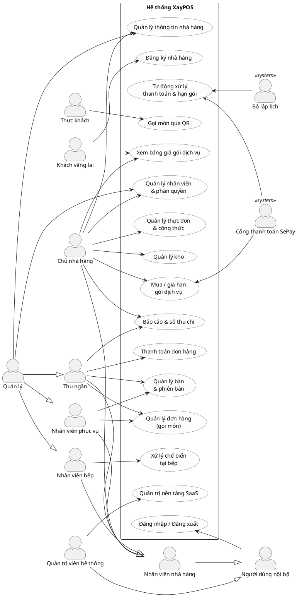

# XayPOS – Phân tích Use Case

Tài liệu được rút ra trực tiếp từ mã nguồn backend `XayPOS_be` (controller, `@PreAuthorize`, migration seed vai trò/quyền, enum trạng thái và tài liệu API trong `docs/`). Sơ đồ viết bằng **PlantUML**; có thể render bằng extension *PlantUML* của VS Code / IntelliJ, hoặc dán vào https://www.plantuml.com/plantuml rồi xuất PNG/SVG để đưa vào báo cáo.

| File | Nội dung |
|---|---|
| [00-tong-quan.md](00-tong-quan.md) | Actor, sơ đồ UC tổng quát, quy ước chung, ma trận Actor – UC |
| [01-xac-thuc-tai-khoan.md](01-xac-thuc-tai-khoan.md) | UC01–UC04: Đăng ký, đăng nhập, đăng xuất, thông tin tài khoản |
| [02-nha-hang-nhan-su.md](02-nha-hang-nhan-su.md) | UC05–UC10: Hồ sơ nhà hàng, nhân viên, phân quyền |
| [03-goi-dich-vu.md](03-goi-dich-vu.md) | UC11–UC17: Gói dịch vụ, mua gói, thanh toán SePay |
| [04-thuc-don-cong-thuc.md](04-thuc-don-cong-thuc.md) | UC18–UC22: Nhóm món, món, nguyên liệu, công thức |
| [05-ban-phien-ban.md](05-ban-phien-ban.md) | UC23–UC28: Khu vực, bàn, QR bàn, phiên bàn |
| [06-don-hang.md](06-don-hang.md) | UC29–UC36: Gọi món, đơn hàng, duyệt QR, hoàn tất |
| [07-bep.md](07-bep.md) | UC37–UC39: Màn hình bếp (KDS) |
| [08-thanh-toan.md](08-thanh-toan.md) | UC40–UC42: Thanh toán đơn hàng |
| [09-goi-mon-qr.md](09-goi-mon-qr.md) | UC43–UC45: Thực khách gọi món qua QR |
| [10-kho.md](10-kho.md) | UC46–UC51: Kho, phiếu kho, kiểm kê, cảnh báo |
| [11-bao-cao-thu-chi.md](11-bao-cao-thu-chi.md) | UC52–UC57: Báo cáo, sổ thu chi |
| [12-quan-tri-he-thong.md](12-quan-tri-he-thong.md) | UC58–UC64: Quản trị nền tảng SaaS |

---

## 1. Giới thiệu hệ thống

XayPOS là hệ thống **POS SaaS đa nhà hàng (multi-tenant)**. Mỗi nhà hàng tự đăng ký tài khoản, mua gói dịch vụ (BASIC / PRO / PREMIUM) và được mở khoá tính năng theo gói. Hệ thống hỗ trợ: quản lý thực đơn – công thức, bàn và phiên phục vụ, gọi món tại quầy/tại bàn/qua QR, màn hình bếp, thanh toán tiền mặt/chuyển khoản, kho nguyên liệu, báo cáo doanh thu – giá vốn, sổ thu chi; và một khu quản trị dành cho nhà cung cấp nền tảng.

## 2. Danh sách Actor

### 2.1. Actor chính (con người)

| # | Actor | Mã vai trò trong hệ thống | Mô tả |
|---|---|---|---|
| A1 | **Khách vãng lai** | – (chưa đăng nhập) | Người truy cập website, xem bảng giá gói và đăng ký nhà hàng mới. |
| A2 | **Thực khách** | – (guest token QR) | Khách đến ăn/mua mang đi; quét QR tại bàn hoặc QR chung của nhà hàng để xem thực đơn và gửi yêu cầu gọi món. Không có tài khoản. |
| A3 | **Chủ nhà hàng** | `OWNER` | Người đăng ký nhà hàng. Có **toàn bộ quyền nghiệp vụ** của nhà hàng; là người duy nhất được mua/gia hạn gói, phân quyền riêng, quản lý kho, công thức, sổ thu chi. |
| A4 | **Quản lý** | `MANAGER` | Điều hành ca: có **mọi quyền vận hành** của Phục vụ, Thu ngân và Bếp (xem thực đơn, bật/tắt món hết, mở/chuyển/đóng bàn, gọi món, huỷ đơn, theo dõi bếp, thu tiền, báo cáo trong ngày), cộng thêm sửa hồ sơ nhà hàng và quản lý nhân viên cấp dưới. Không có các quyền quản trị dành cho chủ (mua gói, phân quyền, sửa thực đơn/công thức, kho, sổ thu chi, báo cáo chi tiết). |
| A5 | **Nhân viên phục vụ** | `WAITER` | Xem thực đơn, mở/đóng/chuyển bàn, tạo đơn và gọi thêm, xác nhận đã mang món ra, hoàn tất đơn. |
| A6 | **Thu ngân** | `CASHIER` | Tạo đơn tại quầy, thu tiền (tiền mặt / chuyển khoản), xem báo cáo trong ngày, đóng phiên, hoàn tất đơn. |
| A7 | **Nhân viên bếp** | `KITCHEN` | Xem hàng chờ bếp, bắt đầu chế biến, báo món xong, xác nhận đã phục vụ. |
| A8 | **Quản trị viên hệ thống** | `SUPER_ADMIN` (không thuộc nhà hàng nào) | Nhà cung cấp nền tảng: quản lý nhà hàng, gói & tính năng, subscription, đối soát thanh toán gói, nhật ký hệ thống. |

Actor trừu tượng dùng để tổng quát hoá:

- **Người dùng nội bộ** – mọi người dùng có tài khoản (A3 → A8). Dùng chung UC đăng nhập/đăng xuất/xem thông tin tài khoản.
- **Nhân viên nhà hàng** – A3 → A7 (người dùng thuộc một nhà hàng – tenant).

### 2.2. Actor phụ (hệ thống bên ngoài / tự động)

| # | Actor | Vai trò |
|---|---|---|
| A9 | **Cổng thanh toán SePay** | Gửi webhook (ký HMAC) báo giao dịch chuyển khoản vào tài khoản của nền tảng; dùng cho mua gói dịch vụ. |
| A10 | **Bộ lập lịch hệ thống (Scheduler)** | Các job định kỳ: hết hạn subscription (`SubscriptionExpirationJob`), hết hạn đơn mua gói (`PurchaseExpirationJob`), xử lý giao dịch SePay (`PaymentEventWorkerJob`), kích hoạt gói đã thanh toán (`PurchaseActivationJob`). |

> Ghi chú: Cloudinary (lưu ảnh món) và ngân hàng của nhà hàng (nhận chuyển khoản VietQR) là dịch vụ hạ tầng, không chủ động khởi tạo UC nên không vẽ thành actor.

### 2.3. Đặc điểm phân quyền

Phân quyền trong XayPOS là **RBAC + ghi đè theo từng người dùng**:

1. Mỗi vai trò hệ thống có bộ quyền mặc định (bảng ở mục 5).
2. Chủ nhà hàng có thể **cấp thêm (ALLOW)** hoặc **chặn (DENY)** từng quyền cho từng nhân viên (UC10). DENY luôn thắng. Chỉ cấp được quyền mà người cấp đang có.
3. Ngoài quyền, mọi chức năng nghiệp vụ còn yêu cầu **tính năng (feature)** tương ứng có trong **gói dịch vụ đang hiệu lực** của nhà hàng (ví dụ `INVENTORY_MANAGEMENT`, `KITCHEN_DISPLAY`).

Vì vậy gắn Actor – UC trong sơ đồ thể hiện **phân quyền mặc định**; trên thực tế, chủ nhà hàng có thể giao thêm UC cho bất kỳ nhân viên nào.

---

## 3. Sơ đồ Use Case tổng quát

> Chủ nhà hàng mặc định có quyền của mọi vai trò nhân viên (G08–G11 cũng thực hiện được); để sơ đồ dễ đọc chỉ vẽ các UC đặc trưng của chủ nhà hàng.
> Quản lý **kế thừa** Phục vụ, Thu ngân và Bếp (quyền mặc định từ migration V47), nên thực hiện được G08–G11 mà không cần vẽ thêm đường nối.

---

## 4. Quy ước chung cho phần đặc tả

### 4.1. Mẫu đặc tả

Mỗi UC được đặc tả theo mẫu: *Mã – Tên – Actor chính/phụ – Mô tả – Tiền điều kiện – Hậu điều kiện – Luồng chính – Luồng thay thế/ngoại lệ – Quy tắc nghiệp vụ*. Mã lỗi trong ngoặc (ví dụ `409 TABLE_ALREADY_OCCUPIED`) là mã lỗi thực tế backend trả về.

### 4.2. Tiền điều kiện chung (viết tắt trong đặc tả)

| Ký hiệu | Ý nghĩa |
|---|---|
| **ĐK-A** | Người dùng đã đăng nhập, tài khoản đang hoạt động, nhà hàng ở trạng thái `ACTIVE`. |
| **ĐK-G(x)** | Nhà hàng có gói dịch vụ **đang hiệu lực** (`ACTIVE` và `startAt ≤ now < endAt`) chứa tính năng `x`. |
| **ĐK-P(x)** | Người dùng có quyền `x` (từ vai trò hoặc được cấp riêng, không bị DENY). |

### 4.3. Ngoại lệ chung (áp dụng cho mọi UC của nhân viên)

| Mã | Tình huống | Xử lý |
|---|---|---|
| **E1** | Chưa đăng nhập / access token hết hạn | `401` – client tự gọi làm mới phiên, thất bại thì về màn hình đăng nhập. |
| **E2** | Tài khoản bị khoá / nhà hàng bị khoá | `401 ACCOUNT_INACTIVE` / `403 RESTAURANT_INACTIVE`. |
| **E3** | Thiếu quyền | `403 FORBIDDEN`; giao diện ẩn chức năng. |
| **E4** | Gói hết hạn hoặc không có tính năng | `403 SUBSCRIPTION_NOT_ACTIVE` / thiếu feature; gợi ý chủ nhà hàng gia hạn/nâng cấp gói. |
| **E5** | Dữ liệu không hợp lệ | `400 VALIDATION_ERROR` kèm `fieldErrors`. |
| **E6** | Xung đột phiên bản (người khác vừa sửa cùng bản ghi) | `409 CONCURRENT_..._UPDATE`; yêu cầu tải lại dữ liệu mới nhất rồi thao tác lại. |
| **E7** | Gửi lại cùng `Idempotency-Key` | Cùng nội dung → trả lại kết quả cũ (không tạo trùng); khác nội dung → `409 IDEMPOTENCY_KEY_REUSED`. |
| **E8** | Truy cập bản ghi của nhà hàng khác | `404 ..._NOT_FOUND` (dữ liệu tenant khác bị ẩn). |

### 4.4. Tính năng theo gói

| Gói | Giá/tháng | Nhóm tính năng chính |
|---|---|---|
| BASIC | 199.000đ | Thực đơn, gọi món nhanh, đơn hàng, thanh toán, doanh thu ngày, QR gọi món, in hoá đơn |
| PRO | 399.000đ | BASIC + bàn, nhân viên, phân quyền, màn hình bếp, QR tại bàn, báo cáo chi tiết |
| PREMIUM | 699.000đ | PRO + kho, công thức, cảnh báo tồn, kiểm kê, phân tích nâng cao |

(Danh mục gói/tính năng do quản trị viên chỉnh được – UC61.)

---

## 5. Ma trận Actor – Use Case (quyền mặc định)

Ký hiệu: ● mặc định có quyền; ○ cần chủ nhà hàng cấp thêm; – không áp dụng.

| UC | Tên | Owner | Manager | Waiter | Cashier | Kitchen | Admin | Khác |
|---|---|:-:|:-:|:-:|:-:|:-:|:-:|---|
| UC01 | Đăng ký nhà hàng | – | – | – | – | – | – | Khách vãng lai |
| UC02–04 | Đăng nhập / đăng xuất / thông tin tài khoản | ● | ● | ● | ● | ● | ● | |
| UC05–07 | Hồ sơ nhà hàng, TK nhận CK, link thực đơn | ● | ● | ○ | ○ | ○ | – | |
| UC08–09 | Quản lý / khoá nhân viên | ● | ● | ○ | ○ | ○ | – | |
| UC10 | Phân quyền nhân viên | ● | ○ | ○ | ○ | ○ | – | |
| UC11 | Xem bảng giá gói | ● | ● | ● | ● | ● | ● | Khách vãng lai |
| UC12 | Xem gói đang dùng | ● | ○ | ○ | ○ | ○ | – | |
| UC13–15 | Mua gói, thanh toán, huỷ đơn mua | ● (chỉ Owner) | – | – | – | – | – | SePay |
| UC16–17 | Đối soát / kích hoạt / hết hạn tự động | – | – | – | – | – | – | SePay, Scheduler |
| UC18–19 | Quản lý nhóm món, món | ● | xem | xem | xem | ○ | – | |
| UC20 | Bật/tắt còn món | ● | ● | ○ | ○ | ○ | – | |
| UC21–22 | Nguyên liệu, công thức | ● | ○ | ○ | ○ | ○ | – | |
| UC23–25 | Khu vực, bàn, QR bàn | ● | xem | xem | xem | ○ | – | |
| UC26 | Mở bàn | ● | ● | ● | ○ | ○ | – | |
| UC27 | Chuyển bàn | ● | ● | ● | ○ | ○ | – | |
| UC28 | Đóng / huỷ phiên bàn | ● | ● | ● | ● | ○ | – | |
| UC29–30 | Tạo đơn, gọi thêm | ● | ● | ● | ● | ○ | – | |
| UC31 | Huỷ món / huỷ đơn | ● | ● | huỷ món nháp | huỷ món nháp | ○ | – | |
| UC32 | Tra cứu đơn | ● | ● | ● | ● | ● | – | |
| UC33–34 | Duyệt / từ chối yêu cầu QR | ● | ● | ● | ● | ○ | – | |
| UC35 | Xác nhận đã phục vụ | ● | ● | ● | ● | ● | – | |
| UC36 | Hoàn tất đơn | ● | ● | ● | ● | ○ | – | |
| UC37–39 | Màn hình bếp | ● | ● | ○ | báo xong | ● | – | |
| UC40–42 | Thanh toán đơn | ● | ● | ○ | ● | ○ | – | |
| UC43–45 | Gọi món qua QR | – | – | – | – | – | – | Thực khách |
| UC46–51 | Kho | ● | ○ | ○ | ○ | ○ | – | |
| UC52 | Báo cáo trong ngày | ● | ● | ○ | ● | ○ | – | |
| UC53–54 | Báo cáo chi tiết, lãi gộp | ● | ○ | ○ | ○ | ○ | – | |
| UC55–57 | Sổ thu chi | ● | ○ | ○ | ○ | ○ | – | |
| UC58–64 | Quản trị nền tảng | – | – | – | – | – | ● | |

---

## 6. Danh sách Use Case theo nhóm chức năng

| Nhóm | Mã | Tên Use Case | Actor chính |
|---|---|---|---|
| **1. Xác thực & tài khoản** | UC01 | Đăng ký nhà hàng | Khách vãng lai |
| | UC02 | Đăng nhập | Người dùng nội bộ |
| | UC03 | Đăng xuất | Người dùng nội bộ |
| | UC04 | Xem thông tin tài khoản & quyền hiệu lực | Người dùng nội bộ |
| **2. Nhà hàng & nhân sự** | UC05 | Xem / cập nhật hồ sơ nhà hàng | Chủ nhà hàng, Quản lý |
| | UC06 | Cấu hình tài khoản nhận chuyển khoản | Chủ nhà hàng, Quản lý |
| | UC07 | Quản lý link & QR thực đơn chung | Chủ nhà hàng, Quản lý |
| | UC08 | Quản lý nhân viên | Chủ nhà hàng, Quản lý |
| | UC09 | Khoá / mở khoá tài khoản nhân viên | Chủ nhà hàng, Quản lý |
| | UC10 | Phân quyền riêng cho nhân viên | Chủ nhà hàng |
| **3. Gói dịch vụ** | UC11 | Xem bảng giá gói dịch vụ | Khách vãng lai, Chủ nhà hàng |
| | UC12 | Xem gói đang dùng & lịch sử gói | Chủ nhà hàng |
| | UC13 | Mua / gia hạn gói dịch vụ | Chủ nhà hàng |
| | UC14 | Thanh toán đơn mua gói bằng QR chuyển khoản | Chủ nhà hàng, SePay |
| | UC15 | Huỷ đơn mua gói | Chủ nhà hàng |
| | UC16 | Đối soát giao dịch chuyển khoản tự động | SePay, Bộ lập lịch |
| | UC17 | Tự động kích hoạt / hết hạn gói | Bộ lập lịch |
| **4. Thực đơn & công thức** | UC18 | Quản lý nhóm món | Chủ nhà hàng |
| | UC19 | Quản lý món ăn | Chủ nhà hàng |
| | UC20 | Cập nhật tình trạng còn / hết món | Chủ nhà hàng, Quản lý |
| | UC21 | Quản lý nguyên liệu | Chủ nhà hàng |
| | UC22 | Quản lý công thức định lượng | Chủ nhà hàng |
| **5. Bàn & phiên bàn** | UC23 | Quản lý khu vực | Chủ nhà hàng |
| | UC24 | Quản lý bàn | Chủ nhà hàng |
| | UC25 | Quản lý mã QR bàn | Chủ nhà hàng |
| | UC26 | Mở bàn | Phục vụ, Quản lý |
| | UC27 | Chuyển bàn | Phục vụ, Quản lý |
| | UC28 | Đóng / huỷ phiên bàn | Phục vụ, Thu ngân, Quản lý |
| **6. Đơn hàng** | UC29 | Tạo đơn hàng | Phục vụ, Thu ngân, Quản lý |
| | UC30 | Gọi thêm / chỉnh sửa món | Phục vụ, Thu ngân, Quản lý |
| | UC31 | Huỷ món / huỷ đơn | Quản lý |
| | UC32 | Tra cứu đơn hàng | Nhân viên nhà hàng |
| | UC33 | Duyệt yêu cầu gọi món QR | Phục vụ, Thu ngân, Quản lý |
| | UC34 | Từ chối yêu cầu gọi món QR | Phục vụ, Thu ngân, Quản lý |
| | UC35 | Xác nhận đã phục vụ | Phục vụ, Thu ngân, Bếp, Quản lý |
| | UC36 | Hoàn tất đơn hàng | Phục vụ, Thu ngân, Quản lý |
| **7. Bếp** | UC37 | Xem hàng chờ bếp | Bếp, Quản lý |
| | UC38 | Bắt đầu chế biến | Bếp, Quản lý |
| | UC39 | Báo món đã xong | Bếp, Thu ngân, Quản lý |
| **8. Thanh toán** | UC40 | Thanh toán đơn hàng | Thu ngân, Quản lý |
| | UC41 | Hiển thị QR chuyển khoản cho đơn | Thu ngân, Quản lý |
| | UC42 | Xem lịch sử thanh toán của đơn | Thu ngân, Quản lý |
| **9. Gọi món qua QR** | UC43 | Xem thực đơn qua QR | Thực khách |
| | UC44 | Gửi yêu cầu gọi món qua QR | Thực khách |
| | UC45 | Theo dõi trạng thái yêu cầu gọi món | Thực khách |
| **10. Kho** | UC46 | Quản lý kho hàng | Chủ nhà hàng |
| | UC47 | Theo dõi tồn kho & đặt ngưỡng tối thiểu | Chủ nhà hàng |
| | UC48 | Lập phiếu nhập / xuất / điều chỉnh kho | Chủ nhà hàng |
| | UC49 | Kiểm kê kho | Chủ nhà hàng |
| | UC50 | Xử lý cảnh báo sắp hết hàng | Chủ nhà hàng |
| | UC51 | Tra cứu lịch sử biến động kho | Chủ nhà hàng |
| **11. Báo cáo & thu chi** | UC52 | Xem báo cáo trong ngày | Chủ nhà hàng, Thu ngân, Quản lý |
| | UC53 | Xem báo cáo chi tiết | Chủ nhà hàng |
| | UC54 | Xem báo cáo lãi gộp tham chiếu | Chủ nhà hàng |
| | UC55 | Xem sổ thu chi | Chủ nhà hàng |
| | UC56 | Ghi khoản chi | Chủ nhà hàng |
| | UC57 | Huỷ khoản chi | Chủ nhà hàng |
| **12. Quản trị nền tảng** | UC58 | Xem bảng điều khiển & doanh thu hệ thống | Quản trị viên |
| | UC59 | Quản lý nhà hàng | Quản trị viên |
| | UC60 | Hỗ trợ tài khoản người dùng nhà hàng | Quản trị viên |
| | UC61 | Quản lý gói & tính năng | Quản trị viên |
| | UC62 | Quản lý subscription của nhà hàng | Quản trị viên |
| | UC63 | Xử lý đơn mua gói & giao dịch cần duyệt | Quản trị viên |
| | UC64 | Xem nhật ký hệ thống | Quản trị viên |
