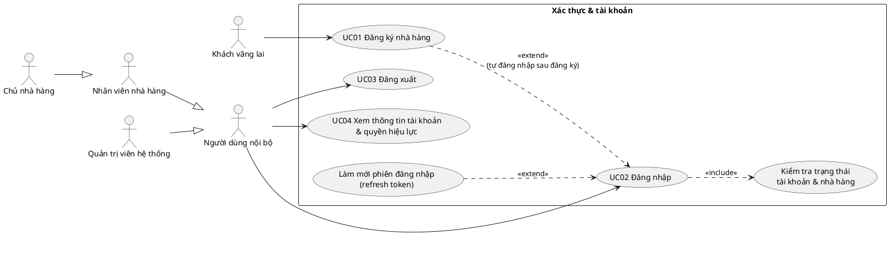

# Nhóm 1 – Xác thực & tài khoản (UC01–UC04)

## Sơ đồ Use Case

---

## UC01 – Đăng ký nhà hàng

| Thuộc tính | Nội dung |
|---|---|
| **Actor chính** | Khách vãng lai |
| **Mô tả** | Người dùng mới tạo một nhà hàng (tenant) cùng tài khoản Chủ nhà hàng để bắt đầu sử dụng hệ thống. |
| **Tiền điều kiện** | Chưa đăng nhập. |
| **Hậu điều kiện** | Tạo nhà hàng trạng thái `ACTIVE`, tài khoản `OWNER` gắn với nhà hàng; trả về access token + refresh token (người dùng được đăng nhập ngay). Nhà hàng **chưa có gói dịch vụ** – phải mua gói (UC13) mới dùng được các chức năng nghiệp vụ. |
| **Kích hoạt** | Người dùng chọn “Đăng ký” trên trang chủ. |

**Luồng chính**
1. Hệ thống hiển thị form đăng ký.
2. Người dùng nhập: mã nhà hàng (2–50 ký tự), tên nhà hàng, tên pháp lý, số điện thoại, địa chỉ, múi giờ, đơn vị tiền tệ (3 ký tự, ví dụ VND), họ tên chủ, email chủ, SĐT chủ, mật khẩu (≥ 8 ký tự).
3. Người dùng nhấn “Đăng ký”.
4. Hệ thống kiểm tra dữ liệu hợp lệ, múi giờ hợp lệ, mã nhà hàng và email chưa tồn tại.
5. Hệ thống mã hoá mật khẩu, tạo nhà hàng, tạo tài khoản OWNER trong cùng một giao dịch.
6. Hệ thống phát hành access token (JWT) và refresh token (cookie httpOnly), ghi nhật ký.
7. Hệ thống chuyển người dùng tới màn hình chọn gói dịch vụ (onboarding).

**Luồng thay thế / ngoại lệ**
- 3a. Cùng một IP gửi quá nhiều yêu cầu đăng ký (mặc định 10 lần/giờ, tính cả yêu cầu lỗi) → `429 TOO_MANY_REQUESTS` kèm `Retry-After`; hệ thống không kiểm tra dữ liệu, không truy cập CSDL.
- 4a. Thiếu trường bắt buộc / sai định dạng email → `400 VALIDATION_ERROR`, đánh dấu trường lỗi.
- 4b. Múi giờ không hợp lệ → `400 INVALID_TIMEZONE`.
- 4c. Mã nhà hàng đã tồn tại → `409 RESTAURANT_CODE_EXISTS`, yêu cầu chọn mã khác.
- 4d. Email đã được dùng → `409 EMAIL_EXISTS`.

**Quy tắc nghiệp vụ**
- BR01-1: Email là duy nhất trên toàn hệ thống (dùng để đăng nhập).
- BR01-2: Đăng ký không tự tạo gói dùng thử; trạng thái nhà hàng và trạng thái gói là độc lập.

---

## UC02 – Đăng nhập

| Thuộc tính | Nội dung |
|---|---|
| **Actor chính** | Người dùng nội bộ (Chủ nhà hàng, Quản lý, Phục vụ, Thu ngân, Bếp, Quản trị viên) |
| **Mô tả** | Xác thực người dùng bằng email và mật khẩu để truy cập hệ thống. |
| **Tiền điều kiện** | Đã có tài khoản. |
| **Hậu điều kiện** | Cấp access token (chứa vai trò, quyền hiệu lực, nhà hàng) và refresh token; lưu thời điểm đăng nhập; ghi nhật ký. |

**Luồng chính**
1. Người dùng mở màn hình đăng nhập, nhập email và mật khẩu.
2. Hệ thống tìm tài khoản theo email và so khớp mật khẩu đã mã hoá.
3. Hệ thống kiểm tra tài khoản đang hoạt động; nếu là nhân viên nhà hàng thì kiểm tra nhà hàng `ACTIVE` (include “Kiểm tra trạng thái tài khoản & nhà hàng”).
4. Hệ thống tính **quyền hiệu lực** = quyền của vai trò + quyền cấp riêng − quyền bị chặn.
5. Hệ thống phát hành access token và refresh token (lưu dạng băm, cookie httpOnly).
6. Hệ thống điều hướng theo vai trò: Quản trị viên → trang quản trị; nhân viên → màn hình POS / bếp tương ứng.

**Luồng thay thế / ngoại lệ**
- 1a. Cùng một IP gửi quá nhiều yêu cầu đăng nhập (mặc định 20 lần/phút) → `429 TOO_MANY_REQUESTS` kèm `Retry-After`.
- 2a. Sai email hoặc mật khẩu → `401 INVALID_CREDENTIALS` (không tiết lộ trường nào sai). Thời gian phản hồi như nhau dù email có tồn tại hay không.
- 2b. Một email bị nhập sai mật khẩu quá số lần (mặc định 5 lần/15 phút, từ bất kỳ IP nào) → email bị khoá tạm: mọi lần đăng nhập, kể cả đúng mật khẩu, nhận `429 LOGIN_TEMPORARILY_LOCKED` kèm `Retry-After` cho tới hết cửa sổ. Email không tồn tại cũng bị khoá y hệt, nên việc bị khoá không tiết lộ email nào đã đăng ký.
- 3a. Tài khoản bị khoá → `401 ACCOUNT_INACTIVE`.
- 3b. Nhà hàng không ở trạng thái `ACTIVE` (bị quản trị viên khoá/tạm ngưng) → `401`, thông báo nhà hàng đang bị khoá.
- A1 (extend – Làm mới phiên): khi access token hết hạn, client gửi refresh token; hệ thống kiểm tra token còn hiệu lực, chưa bị thu hồi, tài khoản/nhà hàng còn hoạt động → **xoay vòng** (thu hồi token cũ, cấp cặp token mới). Token không hợp lệ → `401 INVALID_REFRESH_TOKEN`, buộc đăng nhập lại.

**Quy tắc nghiệp vụ**
- BR02-1: Quyền thay đổi chỉ có hiệu lực sau khi đăng nhập lại hoặc làm mới phiên.
- BR02-2: Khoá tài khoản / cấp mật khẩu tạm sẽ thu hồi toàn bộ refresh token của người đó.
- BR02-3: Đăng nhập thành công xoá bộ đếm số lần sai mật khẩu của email đó. Làm mới phiên bị giới hạn 60 lần/phút mỗi IP (xem `docs/auth-rate-limit.md`).

---

## UC03 – Đăng xuất

| Thuộc tính | Nội dung |
|---|---|
| **Actor chính** | Người dùng nội bộ |
| **Mô tả** | Kết thúc phiên làm việc trên thiết bị hiện tại. |
| **Tiền điều kiện** | Đang đăng nhập. |
| **Hậu điều kiện** | Refresh token hiện tại bị thu hồi, cookie bị xoá; ghi nhật ký đăng xuất. |

**Luồng chính**
1. Người dùng chọn “Đăng xuất”.
2. Hệ thống thu hồi refresh token của phiên hiện tại và xoá cookie.
3. Client xoá access token, quay về màn hình đăng nhập.

**Luồng thay thế / ngoại lệ**
- 2a. Refresh token đã hết hạn / không tồn tại → hệ thống vẫn trả thành công (đăng xuất là idempotent).

---

## UC04 – Xem thông tin tài khoản & quyền hiệu lực

| Thuộc tính | Nội dung |
|---|---|
| **Actor chính** | Người dùng nội bộ |
| **Mô tả** | Lấy thông tin người dùng đang đăng nhập, vai trò, danh sách quyền và danh sách tính năng của gói đang hiệu lực để giao diện hiển thị đúng menu. |
| **Tiền điều kiện** | ĐK-A. |
| **Hậu điều kiện** | Không thay đổi dữ liệu. |

**Luồng chính**
1. Sau khi đăng nhập (hoặc tải lại trang), client yêu cầu thông tin tài khoản.
2. Hệ thống trả về: họ tên, email, vai trò, nhà hàng, danh sách quyền hiệu lực.
3. Client yêu cầu danh sách quyền lợi gói (entitlements).
4. Hệ thống trả về gói đang hiệu lực, danh sách tính năng và giới hạn (ví dụ số nhân viên tối đa).
5. Client ẩn/hiện các chức năng tương ứng.

**Luồng thay thế / ngoại lệ**
- 4a. Nhà hàng chưa có gói hiệu lực → `403 SUBSCRIPTION_NOT_ACTIVE`; giao diện chuyển chủ nhà hàng tới trang mua gói, nhân viên nhận thông báo liên hệ chủ nhà hàng.
