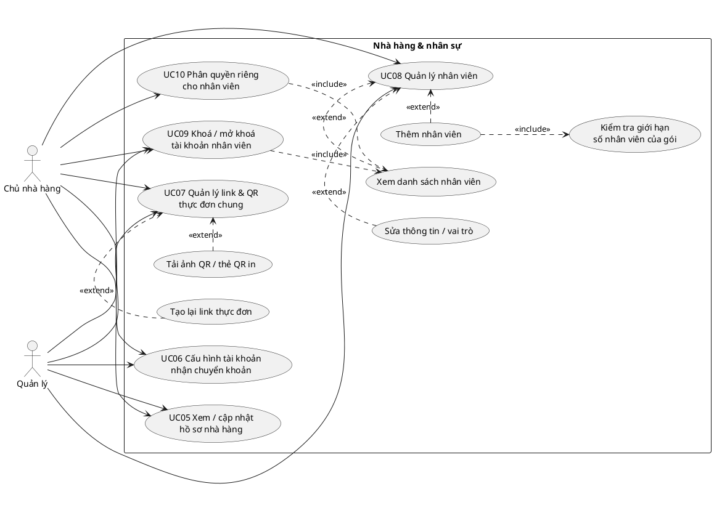

# Nhóm 2 – Nhà hàng & nhân sự (UC05–UC10)

## Sơ đồ Use Case

---

## UC05 – Xem / cập nhật hồ sơ nhà hàng

| Thuộc tính | Nội dung |
|---|---|
| **Actor chính** | Chủ nhà hàng, Quản lý |
| **Mô tả** | Xem và chỉnh sửa thông tin của nhà hàng: tên, tên pháp lý, điện thoại, địa chỉ, múi giờ, tiền tệ… |
| **Tiền điều kiện** | ĐK-A; ĐK-P(`RESTAURANT_PROFILE_VIEW`) để xem, ĐK-P(`RESTAURANT_PROFILE_UPDATE`) để sửa. |
| **Hậu điều kiện** | Hồ sơ được cập nhật; ghi nhật ký `RESTAURANT_PROFILE_UPDATED`. |

**Luồng chính**
1. Actor mở trang “Thông tin nhà hàng”.
2. Hệ thống hiển thị hồ sơ hiện tại (kèm phiên bản dữ liệu).
3. Actor sửa các trường cần thay đổi và nhấn “Lưu”.
4. Hệ thống kiểm tra dữ liệu (múi giờ, mã tiền tệ hợp lệ), cập nhật hồ sơ, ghi nhật ký.
5. Hệ thống hiển thị thông báo thành công và dữ liệu mới.

**Luồng thay thế / ngoại lệ**
- 4a. Không có trường nào thay đổi → `400 EMPTY_UPDATE_REQUEST`.
- 4b. Múi giờ / tiền tệ sai → `400 INVALID_TIMEZONE` / `INVALID_CURRENCY_CODE`.
- 4c. E6 – người khác vừa sửa hồ sơ → yêu cầu tải lại.

**Quy tắc nghiệp vụ**
- BR05-1: Múi giờ của nhà hàng được dùng để tính “ngày” trong báo cáo doanh thu.
- BR05-2: Chức năng không phụ thuộc gói dịch vụ (chủ nhà hàng vẫn sửa được khi gói hết hạn).

---

## UC06 – Cấu hình tài khoản nhận chuyển khoản

| Thuộc tính | Nội dung |
|---|---|
| **Actor chính** | Chủ nhà hàng, Quản lý |
| **Mô tả** | Khai báo tài khoản ngân hàng của nhà hàng (mã ngân hàng/BIN, số tài khoản, tên chủ tài khoản) để hệ thống sinh mã **VietQR** khi khách thanh toán đơn bằng chuyển khoản (UC41). |
| **Tiền điều kiện** | ĐK-A; xem: `RESTAURANT_PROFILE_VIEW`; sửa/xoá: `RESTAURANT_PROFILE_UPDATE`. |
| **Hậu điều kiện** | Tài khoản nhận tiền được lưu / xoá; ghi nhật ký `RESTAURANT_TRANSFER_ACCOUNT_UPDATED` / `..._CLEARED`. |

**Luồng chính**
1. Actor mở mục “Tài khoản nhận chuyển khoản”.
2. Hệ thống hiển thị tài khoản đang cấu hình (nếu có).
3. Actor nhập ngân hàng, số tài khoản, tên chủ tài khoản và lưu.
4. Hệ thống kiểm tra định dạng, lưu cấu hình và ghi nhật ký.

**Luồng thay thế / ngoại lệ**
- 3a. Actor chọn “Xoá cấu hình” → hệ thống xoá tài khoản; từ đó UC41 trả lỗi `TRANSFER_ACCOUNT_NOT_CONFIGURED`.
- 4a. Thông tin tài khoản không hợp lệ → `400 INVALID_TRANSFER_ACCOUNT`.

---

## UC07 – Quản lý link & QR thực đơn chung

| Thuộc tính | Nội dung |
|---|---|
| **Actor chính** | Chủ nhà hàng, Quản lý |
| **Mô tả** | Tạo và quản lý đường link thực đơn công khai của nhà hàng (không gắn bàn) – dùng cho khách xem thực đơn và gọi món **mang đi** (UC43, UC44). Có thể tải ảnh QR / thẻ QR để in, hoặc tạo lại link khi bị lộ. |
| **Tiền điều kiện** | ĐK-A; ĐK-P(`RESTAURANT_PROFILE_UPDATE`). |
| **Hậu điều kiện** | Link (menu token) được khởi tạo / thay mới; ghi nhật ký. |

**Luồng chính**
1. Actor mở mục “Link thực đơn”.
2. Hệ thống hiển thị link hiện tại; nếu chưa có, hiển thị nút “Khởi tạo”.
3. Actor nhấn “Khởi tạo” → hệ thống sinh token ngẫu nhiên, lưu và trả về URL (`RESTAURANT_MENU_LINK_INITIALIZED`).
4. Actor chọn “Tải ảnh QR” (PNG/SVG) hoặc “Tải thẻ QR” (có tên nhà hàng) để in.

**Luồng thay thế / ngoại lệ**
- 4a. (Extend – tạo lại link) Actor chọn “Tạo lại link” và xác nhận → hệ thống sinh token mới, token cũ **mất hiệu lực ngay** (`RESTAURANT_MENU_LINK_ROTATED`); khách dùng QR cũ nhận `404 PUBLIC_MENU_NOT_FOUND`.
- 4b. Tải ảnh QR khi chưa khởi tạo link → `PUBLIC_MENU_LINK_NOT_INITIALIZED`.
- E6 – hai người cùng tạo lại link → `409 CONCURRENT_MENU_LINK_UPDATE`.

---

## UC08 – Quản lý nhân viên

| Thuộc tính | Nội dung |
|---|---|
| **Actor chính** | Chủ nhà hàng, Quản lý |
| **Mô tả** | Xem danh sách, thêm mới và chỉnh sửa tài khoản nhân viên của nhà hàng (họ tên, email, SĐT, vai trò). |
| **Tiền điều kiện** | ĐK-A; ĐK-G(`STAFF_MANAGEMENT`); ĐK-P(`STAFF_VIEW` / `STAFF_CREATE` / `STAFF_UPDATE`). |
| **Hậu điều kiện** | Tài khoản nhân viên được tạo / cập nhật; ghi nhật ký `STAFF_CREATED`, `STAFF_UPDATED`, `STAFF_ROLE_CHANGED`. |

**Luồng chính – Thêm nhân viên**
1. Actor mở “Nhân viên”, hệ thống hiển thị danh sách (lọc theo vai trò, trạng thái, từ khoá) và danh sách vai trò có thể gán.
2. Actor chọn “Thêm nhân viên”, nhập họ tên, email, SĐT, vai trò (`MANAGER`/`WAITER`/`CASHIER`/`KITCHEN`), mật khẩu khởi tạo (≥ 8 ký tự).
3. Hệ thống kiểm tra email chưa tồn tại, vai trò được phép gán, **số nhân viên chưa vượt giới hạn `maxStaff` của gói** (include).
4. Hệ thống tạo tài khoản trạng thái hoạt động, ghi nhật ký, hiển thị nhân viên mới trong danh sách.

**Luồng thay thế – Sửa nhân viên**
- 2a. Actor chọn một nhân viên → “Sửa”, thay đổi thông tin/vai trò → hệ thống kiểm tra phiên bản, cập nhật và ghi nhật ký. Đổi vai trò làm thay đổi bộ quyền mặc định của nhân viên.

**Ngoại lệ**
- 3a. Email đã tồn tại → `409 EMAIL_EXISTS`.
- 3b. Đạt giới hạn nhân viên của gói → `409 STAFF_LIMIT_REACHED`, gợi ý nâng cấp gói.
- 3c. Gán vai trò không cho phép (`OWNER`, `SUPER_ADMIN`) → `STAFF_ROLE_NOT_ALLOWED`.
- 3d. Sửa tài khoản Chủ nhà hàng → `OWNER_ACCOUNT_PROTECTED`; tự sửa vai trò của chính mình → `STAFF_SELF_MANAGEMENT_NOT_ALLOWED`.
- 3e. Quản lý thao tác trên người có quyền cao hơn → `STAFF_TARGET_FORBIDDEN`.
- E6 → `409 CONCURRENT_STAFF_UPDATE`.

---

## UC09 – Khoá / mở khoá tài khoản nhân viên

| Thuộc tính | Nội dung |
|---|---|
| **Actor chính** | Chủ nhà hàng, Quản lý |
| **Mô tả** | Vô hiệu hoá tài khoản nhân viên nghỉ việc hoặc kích hoạt lại. |
| **Tiền điều kiện** | ĐK-A; ĐK-G(`STAFF_MANAGEMENT`); ĐK-P(`STAFF_DISABLE`). |
| **Hậu điều kiện** | Trạng thái tài khoản thay đổi; khi khoá: mọi phiên đăng nhập (refresh token) của nhân viên bị thu hồi; ghi nhật ký `STAFF_DISABLED` / `STAFF_ENABLED`. |

**Luồng chính**
1. Actor chọn nhân viên trong danh sách (include xem danh sách) và nhấn “Khoá tài khoản”.
2. Hệ thống yêu cầu xác nhận.
3. Actor xác nhận.
4. Hệ thống cập nhật trạng thái, thu hồi phiên đăng nhập, ghi nhật ký.
5. Lần gọi API tiếp theo của nhân viên bị từ chối `401 ACCOUNT_INACTIVE`.

**Luồng thay thế / ngoại lệ**
- 1a. Nhân viên đang bị khoá → nút “Mở khoá”; mở khoá phải còn chỗ trong giới hạn `maxStaff` (`STAFF_LIMIT_REACHED`).
- 4a. Khoá tài khoản Chủ nhà hàng hoặc chính mình → `OWNER_ACCOUNT_PROTECTED` / `STAFF_SELF_MANAGEMENT_NOT_ALLOWED`.

---

## UC10 – Phân quyền riêng cho nhân viên

| Thuộc tính | Nội dung |
|---|---|
| **Actor chính** | Chủ nhà hàng (hoặc người được cấp `STAFF_PERMISSION_MANAGE`) |
| **Mô tả** | Ngoài quyền mặc định của vai trò, cấp thêm (ALLOW) hoặc chặn (DENY) từng quyền cụ thể cho từng nhân viên. |
| **Tiền điều kiện** | ĐK-A; ĐK-G(`STAFF_PERMISSION`); ĐK-P(`STAFF_PERMISSION_MANAGE`). |
| **Hậu điều kiện** | Danh sách ghi đè quyền của nhân viên được thay thế; ghi nhật ký `STAFF_PERMISSIONS_UPDATED`. Quyền mới có hiệu lực khi nhân viên đăng nhập lại/làm mới phiên. |

**Luồng chính**
1. Actor mở “Phân quyền” của một nhân viên.
2. Hệ thống hiển thị danh mục quyền theo module (tên & mô tả tiếng Việt), đánh dấu quyền từ vai trò, quyền đang ALLOW/DENY và quyền hiệu lực.
3. Actor bật/tắt quyền (ALLOW / DENY / theo vai trò) và nhấn “Lưu”.
4. Hệ thống kiểm tra từng quyền: tồn tại, được phép gán cho nhân viên, không vừa ALLOW vừa DENY, **người cấp đang có quyền đó**.
5. Hệ thống thay thế toàn bộ danh sách ghi đè, ghi nhật ký và trả về quyền hiệu lực mới.

**Ngoại lệ**
- 4a. Cấp quyền mà bản thân không có → `403 PERMISSION_ESCALATION_NOT_ALLOWED`.
- 4b. Quyền chỉ dành cho chủ nhà hàng/quản trị (ví dụ mua gói, hồ sơ nhà hàng) → `PERMISSION_NOT_ASSIGNABLE`.
- 4c. Một quyền vừa ALLOW vừa DENY → `PERMISSION_EFFECT_CONFLICT`.
- 4d. Mã quyền không tồn tại → `PERMISSION_NOT_FOUND`.

**Quy tắc nghiệp vụ**
- BR10-1: Quyền hiệu lực = (quyền vai trò ∪ ALLOW) − DENY; DENY luôn thắng.
- BR10-2: Có quyền nhưng gói không có tính năng tương ứng thì vẫn không dùng được chức năng.
