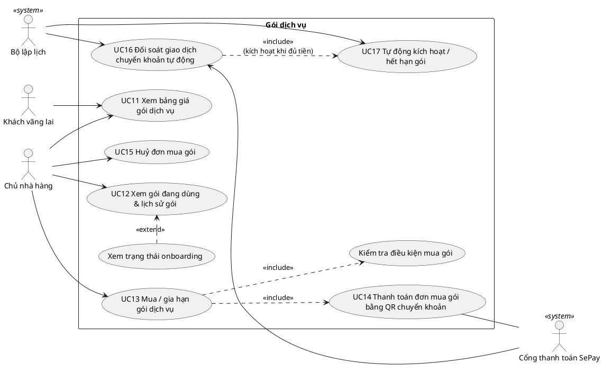
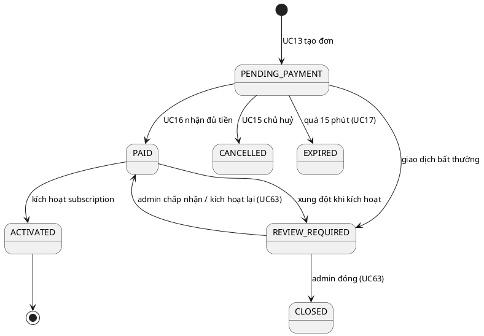

# Nhóm 3 – Gói dịch vụ & mua gói (UC11–UC17)

## Sơ đồ Use Case

### Biểu đồ trạng thái đơn mua gói (tham khảo)

---

## UC11 – Xem bảng giá gói dịch vụ

| Thuộc tính | Nội dung |
|---|---|
| **Actor chính** | Khách vãng lai, Chủ nhà hàng |
| **Mô tả** | Xem danh sách gói đang mở bán, giá, chu kỳ, danh sách tính năng và giới hạn (số nhân viên tối đa). |
| **Tiền điều kiện** | Không (API công khai). |
| **Hậu điều kiện** | Không thay đổi dữ liệu. |

**Luồng chính**
1. Actor mở trang “Bảng giá”.
2. Hệ thống trả về các gói đang hoạt động (BASIC, PRO, PREMIUM…) kèm giá, chu kỳ tháng, tính năng.
3. Actor chọn một gói để xem chi tiết; hệ thống hiển thị chi tiết gói.

**Ngoại lệ**
- 3a. Gói không tồn tại hoặc đã ngừng bán → `404 PACKAGE_NOT_FOUND`.

---

## UC12 – Xem gói đang dùng & lịch sử gói

| Thuộc tính | Nội dung |
|---|---|
| **Actor chính** | Chủ nhà hàng |
| **Mô tả** | Xem gói đang hiệu lực (ngày bắt đầu, ngày hết hạn, tính năng đã chốt) và lịch sử các gói đã dùng; xem trạng thái onboarding để biết bước tiếp theo. |
| **Tiền điều kiện** | ĐK-A; ĐK-P(`SUBSCRIPTION_VIEW`). |
| **Hậu điều kiện** | Không thay đổi dữ liệu. |

**Luồng chính**
1. Actor mở “Gói dịch vụ của tôi”.
2. Hệ thống trả về subscription hiện tại: gói, trạng thái, `startAt`, `endAt`, ảnh chụp tính năng (feature snapshot).
3. Actor chọn tab “Lịch sử” → hệ thống trả danh sách subscription đã có (phân trang).
4. (Extend) Client gọi trạng thái onboarding → hệ thống trả hành động gợi ý: `OPEN_APP` (đang có gói), `PURCHASE_REQUIRED` (cần mua), `WAIT_ACTIVATION` (đã trả tiền, đang kích hoạt), `VIEW_PURCHASE` (có đơn đang chờ thanh toán), `CONTACT_SUPPORT` (đơn cần quản trị viên xử lý).

**Ngoại lệ**
- 2a. Chưa có gói hiệu lực → `403 SUBSCRIPTION_NOT_ACTIVE`; giao diện hiển thị nút “Mua gói”.

**Quy tắc nghiệp vụ**
- BR12-1: Gói hiệu lực khi trạng thái `ACTIVE` và `startAt ≤ now < endAt`. Tính năng lấy từ **snapshot** chốt tại lúc kích hoạt, không đổi khi quản trị viên sửa gói sau đó.

---

## UC13 – Mua / gia hạn gói dịch vụ

| Thuộc tính | Nội dung |
|---|---|
| **Actor chính** | Chủ nhà hàng |
| **Actor phụ** | Cổng thanh toán SePay (qua UC14) |
| **Mô tả** | Chủ nhà hàng chọn gói và tạo **đơn mua gói**; hệ thống chốt báo giá (giá, tính năng, chu kỳ) trong 15 phút rồi chuyển sang thanh toán. |
| **Tiền điều kiện** | ĐK-A; vai trò `OWNER` và ĐK-P(`SUBSCRIPTION_PURCHASE_CREATE`). Không yêu cầu gói đang hiệu lực. |
| **Hậu điều kiện** | Tạo đơn mua `PENDING_PAYMENT` với báo giá bất biến, hạn thanh toán = thời điểm tạo + 15 phút; ghi nhật ký `SUBSCRIPTION_PURCHASE_CREATED`. |

**Luồng chính**
1. Actor chọn gói trên trang bảng giá (UC11) và nhấn “Mua gói”.
2. Client gửi mã gói kèm `Idempotency-Key`.
3. Hệ thống kiểm tra điều kiện mua gói (include):
   - nhà hàng không có gói `ACTIVE` chưa hết hạn, không có subscription `PENDING` do admin gán;
   - nhà hàng chưa có đơn mua đang mở (`PENDING_PAYMENT`/`PAID`/`REVIEW_REQUIRED`);
   - gói đang mở bán, giá > 0, tiền tệ VND.
4. Hệ thống chốt báo giá: giá, chu kỳ tháng, danh sách tính năng, `maxStaff`, thời điểm báo giá và hạn 15 phút.
5. Hệ thống lưu đơn mua, ghi nhật ký và trả về thông tin đơn.
6. Hệ thống chuyển tiếp sang UC14 để tạo mã thanh toán.

**Luồng thay thế / ngoại lệ**
- 3a. Đang có gói hiệu lực → `409 SUBSCRIPTION_ALREADY_ACTIVE` (MVP chưa hỗ trợ gia hạn sớm / đổi gói giữa kỳ).
- 3b. Đã có đơn mua đang mở → `409 OPEN_PURCHASE_EXISTS` kèm đơn hiện tại; client chuyển sang đơn đó.
- 3c. Gói không bán được (giá 0, ngoại tệ, ngừng bán) → `422 PACKAGE_NOT_PURCHASABLE` / `PACKAGE_INACTIVE`.
- 3d. Hệ thống tạm ngừng nhận đơn mới → `503 PURCHASE_UNAVAILABLE`.
- 3e. Người dùng không phải Chủ nhà hàng → `403 PURCHASE_PERMISSION_REQUIRED`.
- E7 – gửi lại cùng key → trả lại đơn cũ.

**Quy tắc nghiệp vụ**
- BR13-1: Mỗi nhà hàng tối đa **một** đơn mua đang mở.
- BR13-2: Báo giá bất biến: sửa giá/tính năng gói sau khi tạo đơn không ảnh hưởng đơn đã tạo.

---

## UC14 – Thanh toán đơn mua gói bằng QR chuyển khoản

| Thuộc tính | Nội dung |
|---|---|
| **Actor chính** | Chủ nhà hàng |
| **Actor phụ** | Cổng thanh toán SePay |
| **Mô tả** | Hệ thống tạo **lượt thanh toán** gồm mã chuyển khoản duy nhất và QR (VietQR) vào tài khoản của nền tảng; chủ nhà hàng quét QR bằng app ngân hàng để chuyển tiền. |
| **Tiền điều kiện** | Đơn mua ở trạng thái `PENDING_PAYMENT`, chưa hết hạn. ĐK-P(`SUBSCRIPTION_PURCHASE_CREATE`). |
| **Hậu điều kiện** | Có một lượt thanh toán `PENDING` (cùng hạn với đơn); ghi nhật ký `SUBSCRIPTION_PAYMENT_ATTEMPT_CREATED`. |

**Luồng chính**
1. Actor ở màn hình chi tiết đơn mua, nhấn “Thanh toán”.
2. Hệ thống kiểm tra đơn còn hạn và chưa có lượt thanh toán đang chờ.
3. Hệ thống sinh mã tham chiếu chuyển khoản duy nhất, chọn tài khoản nhận của nền tảng, dựng QR với số tiền đúng bằng giá đơn.
4. Hệ thống trả QR, số tài khoản, ngân hàng, số tiền, nội dung chuyển khoản và thời gian còn lại.
5. Actor quét QR và chuyển khoản trên app ngân hàng.
6. Client định kỳ lấy “lượt thanh toán hiện tại” / trạng thái đơn để cập nhật màn hình.
7. Khi UC16 ghi nhận tiền, đơn chuyển `PAID` → `ACTIVATED`; màn hình báo “Kích hoạt gói thành công”.

**Luồng thay thế / ngoại lệ**
- 2a. Đã có lượt thanh toán đang chờ → trả lại lượt đó (`PAYMENT_ATTEMPT_PENDING`), không sinh mã mới.
- 2b. Đơn đã hết hạn → `PURCHASE_PERIOD_EXPIRED`; actor tạo đơn mới (UC13).
- 2c. Đơn đã thanh toán / không thể thanh toán → `PURCHASE_ALREADY_PAID` / `PURCHASE_NOT_PAYABLE`.
- 3a. Không lấy được thông tin nhà cung cấp thanh toán → `PAYMENT_PROVIDER_UNAVAILABLE`.
- 7a. Chuyển sai số tiền / sai nội dung → giao dịch vào trạng thái cần duyệt; chủ nhà hàng liên hệ hỗ trợ, quản trị viên xử lý ở UC63.

**Quy tắc nghiệp vụ**
- BR14-1: Tiền chuyển vào **tài khoản của nền tảng**, không phải của nhà hàng; không dùng chung luồng thanh toán đơn món ăn.
- BR14-2: Mỗi đơn mua chỉ có tối đa một lượt thanh toán `PENDING`; lượt thanh toán không gia hạn quá hạn của đơn.

---

## UC15 – Huỷ đơn mua gói

| Thuộc tính | Nội dung |
|---|---|
| **Actor chính** | Chủ nhà hàng |
| **Mô tả** | Huỷ đơn mua chưa thanh toán (chọn nhầm gói…) để có thể tạo đơn khác. |
| **Tiền điều kiện** | ĐK-P(`SUBSCRIPTION_PURCHASE_CANCEL`); đơn ở `PENDING_PAYMENT` và chưa nhận tiền. |
| **Hậu điều kiện** | Đơn chuyển `CANCELLED`, lượt thanh toán đang chờ bị huỷ; giải phóng “slot” đơn mở; ghi nhật ký `SUBSCRIPTION_PURCHASE_CANCELLED`. |

**Luồng chính**
1. Actor mở chi tiết đơn mua, nhấn “Huỷ đơn”, nhập lý do (tuỳ chọn) và xác nhận.
2. Hệ thống khoá đơn, kiểm tra trạng thái cho phép huỷ.
3. Hệ thống cập nhật đơn và lượt thanh toán sang `CANCELLED`, ghi nhật ký.

**Ngoại lệ**
- 2a. Đơn đã nhận tiền / đang kích hoạt → `409 PURCHASE_CANNOT_CANCEL` / `PURCHASE_ALREADY_PAID`.
- 2b. Đơn đã huỷ trước đó → trả thành công (idempotent).
- 3a. Tiền về **sau** khi đơn đã huỷ → giao dịch được UC16 đưa vào diện cần duyệt (không tự kích hoạt).

---

## UC16 – Đối soát giao dịch chuyển khoản tự động

| Thuộc tính | Nội dung |
|---|---|
| **Actor chính** | Cổng thanh toán SePay (khởi tạo), Bộ lập lịch (`PaymentEventWorkerJob`) |
| **Mô tả** | SePay gửi webhook mỗi khi tài khoản nền tảng có giao dịch. Hệ thống xác thực, lưu vào hộp thư (inbox) rồi worker định kỳ đối chiếu với đơn mua để xác nhận thanh toán. |
| **Tiền điều kiện** | Webhook có chữ ký HMAC hợp lệ. |
| **Hậu điều kiện** | Giao dịch được lưu đúng một lần; nếu khớp: đơn mua `PAID`, lượt thanh toán `SUCCESS`, tiếp tục kích hoạt (UC17). Nếu không khớp: giao dịch/đơn ở `REVIEW_REQUIRED`. |

**Luồng chính**
1. SePay gửi `POST` webhook chứa thông tin giao dịch (mã giao dịch, số tiền, nội dung, tài khoản nhận, chiều tiền).
2. Hệ thống kiểm tra chữ ký HMAC trên dữ liệu gốc, chống gửi lặp (khử trùng theo mã giao dịch nhà cung cấp).
3. Hệ thống lưu giao dịch vào inbox (`SUBSCRIPTION_PAYMENT_EVENT_RECEIVED`) và trả `200` ngay cho SePay.
4. Bộ lập lịch định kỳ lấy các giao dịch chưa xử lý.
5. Worker trích mã tham chiếu trong nội dung chuyển khoản, tìm đơn mua và lượt thanh toán tương ứng.
6. Worker kiểm tra: tiền vào, đúng tài khoản nhận, đúng số tiền, đơn còn `PENDING_PAYMENT`, giao dịch trong thời hạn.
7. Worker ghi đơn `PAID`, lượt thanh toán `SUCCESS`, đánh dấu giao dịch đã xử lý (`SUBSCRIPTION_PURCHASE_PAID`).
8. Worker gọi kích hoạt gói (include UC17).

**Luồng thay thế / ngoại lệ**
- 2a. Sai chữ ký → `401`, không lưu.
- 2b. Webhook gửi lại (trùng mã giao dịch) → trả `200`, tăng bộ đếm, không xử lý lại.
- 6a. Không tìm thấy đơn / sai số tiền / đơn đã hết hạn hoặc huỷ / tiền ra → giao dịch chuyển `REVIEW_REQUIRED` với lý do; quản trị viên xử lý ở UC63.
- 7a. Lỗi tạm thời → giao dịch về hàng chờ thử lại với thời gian chờ tăng dần.

**Quy tắc nghiệp vụ**
- BR16-1: Không bao giờ yêu cầu khách trả tiền lần hai khi đã ghi nhận `PAID`.
- BR16-2: Không xoá dữ liệu tiền đã nhận; hoàn tiền (nếu có) xử lý ngoài hệ thống.

---

## UC17 – Tự động kích hoạt / hết hạn gói

| Thuộc tính | Nội dung |
|---|---|
| **Actor chính** | Bộ lập lịch hệ thống |
| **Mô tả** | (a) Kích hoạt subscription cho đơn mua đã `PAID`; (b) chuyển đơn mua quá hạn 15 phút sang `EXPIRED`; (c) chuyển subscription đến `endAt` sang `EXPIRED`. |
| **Tiền điều kiện** | Job được lập lịch chạy định kỳ. |
| **Hậu điều kiện** | Trạng thái đơn mua / subscription được cập nhật, ghi nhật ký `SUBSCRIPTION_PURCHASE_ACTIVATED`, `SUBSCRIPTION_PURCHASE_EXPIRED`, `SUBSCRIPTION_EXPIRED`. |

**Luồng chính (a) – Kích hoạt**
1. `PurchaseActivationJob` lấy các đơn `PAID` chưa kích hoạt (có cơ chế lease tránh xử lý trùng).
2. Hệ thống khoá nhà hàng, kiểm tra không có gói hiệu lực chồng lấn.
3. Hệ thống tạo subscription `ACTIVE`: `startAt = now`, `endAt = startAt + số tháng` (múi giờ Asia/Ho_Chi_Minh), sao chép tính năng/giới hạn từ báo giá thành snapshot.
4. Đơn mua chuyển `ACTIVATED`, liên kết subscription; ghi nhật ký.

**Luồng chính (b) – Hết hạn đơn mua**
1. `PurchaseExpirationJob` tìm đơn `PENDING_PAYMENT` có `expiresAt ≤ now`.
2. Chuyển đơn và lượt thanh toán sang `EXPIRED`.

**Luồng chính (c) – Hết hạn gói**
1. `SubscriptionExpirationJob` tìm subscription `ACTIVE` có `endAt ≤ now`.
2. Chuyển sang `EXPIRED`; từ thời điểm này các UC nghiệp vụ của nhà hàng trả `SUBSCRIPTION_NOT_ACTIVE` cho đến khi mua gói mới.

**Ngoại lệ**
- a2a. Lỗi tạm thời → giữ `PAID`, tăng số lần thử, thử lại sau.
- a2b. Xung đột nghiệp vụ (đã có gói khác, nhà hàng bị khoá) → đơn `REVIEW_REQUIRED`; quản trị viên dùng “Kích hoạt lại” (UC63).
