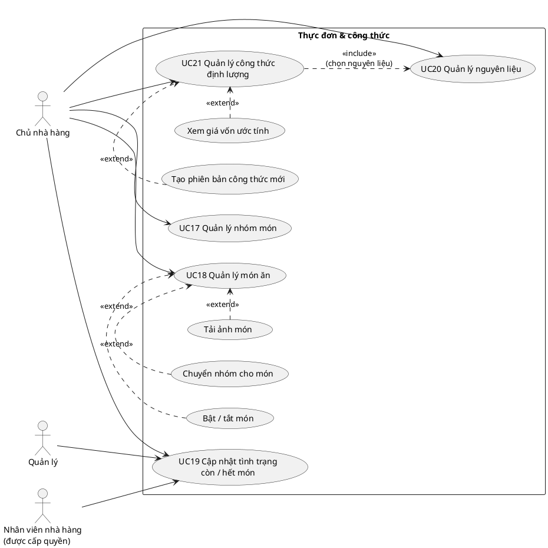

# Nhóm 4 – Thực đơn & công thức (UC17–UC21)

## Sơ đồ Use Case

---

## UC17 – Quản lý nhóm món

| Thuộc tính | Nội dung |
|---|---|
| **Actor chính** | Chủ nhà hàng (Quản lý, Phục vụ, Thu ngân chỉ xem với `MENU_VIEW`) |
| **Mô tả** | Thêm, sửa, bật/tắt, xoá nhóm món (ví dụ “Đồ uống”, “Món chính”) để sắp xếp thực đơn. |
| **Tiền điều kiện** | ĐK-A; ĐK-G(`MENU_MANAGEMENT`); ĐK-P(`MENU_VIEW`/`MENU_CREATE`/`MENU_UPDATE`/`MENU_DELETE`). |
| **Hậu điều kiện** | Nhóm món được tạo/cập nhật/xoá mềm; ghi nhật ký `MENU_GROUP_CREATED`/`UPDATED`/`ENABLED`/`DISABLED`/`DELETED`. |

**Luồng chính – Thêm nhóm**
1. Actor mở “Thực đơn → Nhóm món”; hệ thống hiển thị danh sách nhóm (tìm kiếm, lọc trạng thái).
2. Actor chọn “Thêm nhóm”, nhập tên, mô tả, thứ tự hiển thị.
3. Hệ thống kiểm tra tên nhóm chưa trùng, lưu nhóm và hiển thị trong danh sách.

**Luồng thay thế**
- 2a. Sửa nhóm: chọn nhóm → sửa thông tin → hệ thống kiểm tra phiên bản và lưu.
- 2b. Bật/tắt nhóm: nhóm bị tắt sẽ không hiển thị ra thực đơn bán hàng và thực đơn QR.
- 2c. Xoá nhóm: hệ thống yêu cầu xác nhận rồi xoá mềm.

**Ngoại lệ**
- 3a. Trùng tên → `409 MENU_GROUP_NAME_EXISTS`.
- 2c-a. Nhóm còn món → `409 MENU_GROUP_NOT_EMPTY`; yêu cầu chuyển món sang nhóm khác trước.
- E6 → `409 CONCURRENT_MENU_UPDATE`.

---

## UC18 – Quản lý món ăn

| Thuộc tính | Nội dung |
|---|---|
| **Actor chính** | Chủ nhà hàng |
| **Mô tả** | Thêm, sửa, bật/tắt, xoá món; tải ảnh món; chuyển nhóm; cấu hình giá bán, giá vốn, đơn vị, cách trừ kho (theo công thức hoặc bán trực tiếp từ kho). |
| **Tiền điều kiện** | ĐK-A; ĐK-G(`MENU_MANAGEMENT`); ĐK-P(`MENU_CREATE`/`MENU_UPDATE`/`MENU_DELETE`). |
| **Hậu điều kiện** | Món được lưu; ghi nhật ký `MENU_ITEM_CREATED`/`UPDATED`/`GROUP_CHANGED`/`ENABLED`/`DISABLED`/`DELETED`. |

**Luồng chính – Thêm món**
1. Actor mở “Thực đơn → Món”, hệ thống hiển thị danh sách món (lọc theo nhóm, trạng thái, tình trạng còn hàng, từ khoá).
2. Actor chọn “Thêm món”, nhập: nhóm, SKU, tên, đơn vị tính, mô tả, giá bán, giá vốn (tuỳ chọn), cờ áp dụng công thức (`recipeEnabled`), cờ theo dõi tồn kho trực tiếp (`trackInventory`).
3. (Extend) Actor chọn ảnh → hệ thống kiểm tra định dạng/kích thước, tải lên kho ảnh (Cloudinary) và trả URL.
4. Actor nhấn “Lưu”.
5. Hệ thống kiểm tra SKU chưa trùng, nhóm đang hoạt động, giá ≥ 0, cấu hình giá vốn hợp lệ; lưu món ở trạng thái hoạt động + còn hàng.

**Luồng thay thế**
- 2a. Sửa món: thay đổi thông tin/giá → lưu kèm `expectedVersion`. Đơn đã tạo **giữ nguyên giá cũ** (giá được chụp vào dòng đơn).
- 2b. Chuyển nhóm: chọn nhóm đích → hệ thống cập nhật (`MENU_ITEM_GROUP_CHANGED`).
- 2c. Tắt món: món không còn bán được ở POS và QR.
- 2d. Xoá món: xác nhận → xoá mềm; lịch sử đơn vẫn giữ.

**Ngoại lệ**
- 3a. Ảnh sai định dạng / quá lớn → `INVALID_IMAGE` / `IMAGE_TOO_LARGE`.
- 5a. SKU trùng → `409 SKU_EXISTS`.
- 5b. Nhóm đã tắt → `MENU_GROUP_INACTIVE`.
- 5c. Đánh dấu “đã cấu hình giá vốn” nhưng thiếu giá → `COST_PRICE_REQUIRED`.
- 5d. Bật trừ kho trực tiếp trong khi món đang áp dụng công thức → `INVENTORY_TRACKING_MODE_CONFLICT`.
- 2d-a. Món đang có công thức hoạt động → `MENU_ITEM_HAS_ACTIVE_RECIPE` (phải ngừng công thức trước).

**Quy tắc nghiệp vụ**
- BR18-1: Một món chỉ trừ kho theo **một** cách: theo công thức (UC21) hoặc trực tiếp như hàng hoá (ví dụ nước đóng chai).
- BR18-2: Đổi đơn vị tính bị chặn khi đơn vị đang được công thức/kho sử dụng (`MENU_ITEM_UNIT_IN_USE`).

---

## UC19 – Cập nhật tình trạng còn / hết món

| Thuộc tính | Nội dung |
|---|---|
| **Actor chính** | Chủ nhà hàng, Quản lý; nhân viên khác được cấp `MENU_AVAILABILITY_UPDATE` (thường là bếp/thu ngân) |
| **Mô tả** | Đánh dấu món **tạm hết** hoặc **có bán trở lại** trong ca mà không được sửa thông tin món. |
| **Tiền điều kiện** | ĐK-A; ĐK-G(`MENU_MANAGEMENT`); ĐK-P(`MENU_AVAILABILITY_UPDATE`). |
| **Hậu điều kiện** | Trạng thái `AVAILABLE` ↔ `OUT_OF_STOCK` được cập nhật; ghi nhật ký `MENU_ITEM_AVAILABILITY_CHANGED`. |

**Luồng chính**
1. Actor mở danh sách món, chọn món và bật/tắt “Còn hàng”.
2. Hệ thống kiểm tra phiên bản và cập nhật trạng thái.
3. Món hết hàng hiển thị “Tạm hết” trên POS và thực đơn QR, không cho gọi thêm.

**Ngoại lệ**
- 3a. Khi tạo đơn/duyệt QR có món đã hết → `ITEM_OUT_OF_STOCK`.

---

## UC20 – Quản lý nguyên liệu

| Thuộc tính | Nội dung |
|---|---|
| **Actor chính** | Chủ nhà hàng |
| **Mô tả** | Quản lý danh mục nguyên liệu (thịt, rau, gia vị…): tên, SKU, đơn vị, giá vốn tham chiếu, có theo dõi tồn kho hay không. |
| **Tiền điều kiện** | ĐK-A; ĐK-G(`RECIPE_MANAGEMENT` hoặc `INVENTORY_MANAGEMENT`); ĐK-P(`INGREDIENT_VIEW`/`CREATE`/`UPDATE`/`DELETE`). |
| **Hậu điều kiện** | Nguyên liệu được lưu; ghi nhật ký `INGREDIENT_CREATED`/`UPDATED`/`ENABLED`/`DISABLED`/`DELETED`. |

**Luồng chính**
1. Actor mở “Nguyên liệu”; hệ thống hiển thị danh sách (tìm kiếm, lọc trạng thái).
2. Actor chọn “Thêm”, nhập tên, SKU, đơn vị cơ bản, giá vốn tham chiếu, cờ theo dõi tồn.
3. Hệ thống kiểm tra SKU chưa trùng và lưu.

**Luồng thay thế**
- 2a. Sửa nguyên liệu (kiểm tra phiên bản). Thay đổi giá vốn tham chiếu làm hệ thống tính lại giá vốn ước tính của món (`INGREDIENT_COST_RECALCULATED`).
- 2b. Bật/tắt nguyên liệu.
- 2c. Xoá nguyên liệu (xoá mềm).

**Ngoại lệ**
- 3a. SKU trùng → `409 SKU_EXISTS`.
- 2a-a. Đổi đơn vị khi đang dùng trong công thức/kho → `INGREDIENT_UNIT_IN_USE`.
- 2b-a / 2c-a. Nguyên liệu đang dùng trong công thức hoạt động → `INGREDIENT_USED_BY_ACTIVE_RECIPE`; còn tồn kho → `INGREDIENT_HAS_STOCK`; đang được giữ chỗ cho đơn → `INGREDIENT_HAS_RESERVATIONS`.

---

## UC21 – Quản lý công thức định lượng

| Thuộc tính | Nội dung |
|---|---|
| **Actor chính** | Chủ nhà hàng |
| **Mô tả** | Khai báo công thức của món: danh sách nguyên liệu và định lượng cho một đơn vị món. Công thức có **phiên bản** (1, 2, 3…); sửa công thức = tạo phiên bản mới. Xem giá vốn ước tính theo giá tham chiếu nguyên liệu. |
| **Tiền điều kiện** | ĐK-A; ĐK-G(`RECIPE_MANAGEMENT`); ĐK-P(`RECIPE_VIEW`/`RECIPE_CREATE`/`RECIPE_UPDATE`/`RECIPE_DELETE`). |
| **Hậu điều kiện** | Công thức/phiên bản mới được lưu và là phiên bản hoạt động; phiên bản cũ được giữ làm lịch sử; ghi nhật ký `RECIPE_CREATED` / `RECIPE_VERSION_CREATED` / `RECIPE_DEACTIVATED`. |

**Luồng chính – Tạo công thức đầu tiên**
1. Actor mở chi tiết món, chọn tab “Công thức”.
2. Hệ thống hiển thị công thức đang hoạt động (nếu có) và lịch sử phiên bản.
3. Actor chọn “Tạo công thức”, thêm các dòng: nguyên liệu (include UC20 – chọn từ danh mục), định lượng, ghi chú.
4. Hệ thống kiểm tra: món chưa có công thức hoạt động, có ít nhất một nguyên liệu, không trùng nguyên liệu, nguyên liệu đang hoạt động, đơn vị khớp, định lượng trong giới hạn.
5. Hệ thống chụp tên/SKU/đơn vị nguyên liệu, lưu công thức phiên bản 1.
6. (Extend) Actor chọn “Giá vốn ước tính” → hệ thống tính tổng (định lượng × giá tham chiếu) và cảnh báo nguyên liệu chưa có giá.

**Luồng thay thế**
- 3a. (Extend – phiên bản mới) Món đã có công thức → actor chọn “Cập nhật”, chỉnh danh sách → hệ thống tạo phiên bản mới thay thế phiên bản đang dùng; đơn đã gửi bếp vẫn giữ snapshot phiên bản cũ.
- 3b. Ngừng dùng công thức → hệ thống kiểm tra món đã tắt “áp dụng công thức” rồi vô hiệu hoá công thức.

**Ngoại lệ**
- 4a. Đã có công thức hoạt động → `409 ACTIVE_RECIPE_ALREADY_EXISTS`.
- 4b. Danh sách rỗng / trùng nguyên liệu / quá nhiều dòng → `RECIPE_INGREDIENTS_REQUIRED` / `DUPLICATE_RECIPE_INGREDIENT` / `TOO_MANY_RECIPE_INGREDIENTS`.
- 4c. Sai đơn vị / nguyên liệu ngừng dùng → `RECIPE_INGREDIENT_UNIT_MISMATCH` / `RECIPE_INGREDIENT_UNAVAILABLE`.
- 3a-a. Phiên bản mới giống hệt phiên bản hiện tại → `SAME_RECIPE_VERSION_NOT_ALLOWED`.
- 3b-a. Món vẫn đang áp dụng công thức → `409 RECIPE_APPLICATION_ENABLED`.

**Quy tắc nghiệp vụ**
- BR21-1: Khi đơn được gửi bếp, hệ thống **chụp (snapshot)** công thức và giá vốn tham chiếu vào từng dòng đơn – dùng để trừ kho (UC37) và tính lãi gộp (UC53).
- BR21-2: Công thức không hiển thị ra thực đơn công khai/QR.
