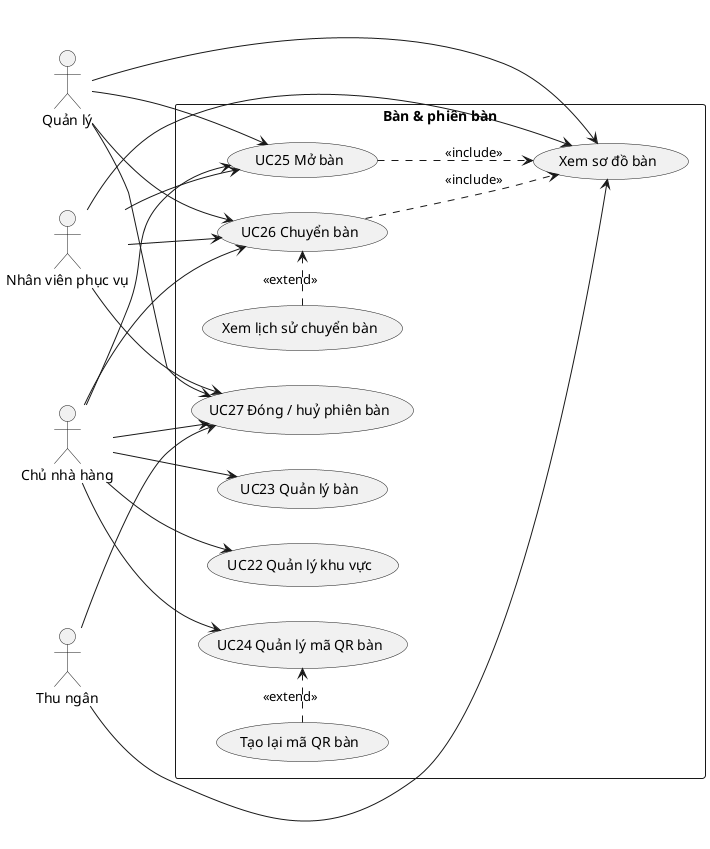
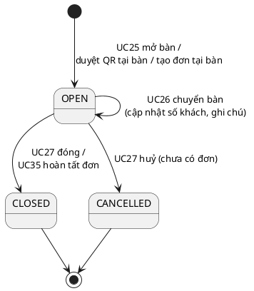

# Nhóm 5 – Bàn & phiên bàn (UC22–UC27)

## Sơ đồ Use Case

### Biểu đồ trạng thái phiên bàn

---

## UC22 – Quản lý khu vực

| Thuộc tính | Nội dung |
|---|---|
| **Actor chính** | Chủ nhà hàng |
| **Mô tả** | Thêm, sửa, bật/tắt, xoá khu vực (Tầng 1, Sân vườn, Phòng VIP…) để nhóm bàn. |
| **Tiền điều kiện** | ĐK-A; ĐK-G(`TABLE_MANAGEMENT`); ĐK-P(`TABLE_VIEW`/`TABLE_CREATE`/`TABLE_UPDATE`). |
| **Hậu điều kiện** | Khu vực được lưu; ghi nhật ký `TABLE_AREA_CREATED`/`UPDATED`/`ENABLED`/`DISABLED`/`DELETED`. |

**Luồng chính**
1. Actor mở “Bàn → Khu vực”; hệ thống hiển thị danh sách khu vực.
2. Actor chọn “Thêm khu vực”, nhập tên, mô tả, thứ tự.
3. Hệ thống kiểm tra tên chưa trùng và lưu.

**Luồng thay thế**
- 2a. Sửa khu vực (kiểm tra phiên bản).
- 2b. Tắt khu vực → bàn trong khu vực không mở được phiên mới.
- 2c. Xoá khu vực (xác nhận, xoá mềm).

**Ngoại lệ**
- 3a. Trùng tên → `409 TABLE_AREA_NAME_EXISTS`.
- 2b-a. Khu vực đang có phiên bàn mở → `409 TABLE_AREA_HAS_OPEN_SESSIONS`.
- 2c-a. Khu vực còn bàn → `409 TABLE_AREA_NOT_EMPTY`.

---

## UC23 – Quản lý bàn

| Thuộc tính | Nội dung |
|---|---|
| **Actor chính** | Chủ nhà hàng |
| **Mô tả** | Thêm, sửa (mã bàn, tên, sức chứa), chuyển khu vực, bật/tắt, xoá bàn. Xem sơ đồ bàn với trạng thái trống/đang phục vụ. |
| **Tiền điều kiện** | ĐK-A; ĐK-G(`TABLE_MANAGEMENT`); ĐK-P(`TABLE_VIEW`/`TABLE_CREATE`/`TABLE_UPDATE`). |
| **Hậu điều kiện** | Bàn được lưu; khi tạo bàn hệ thống sinh sẵn mã QR riêng; ghi nhật ký `TABLE_CREATED`/`UPDATED`/`ENABLED`/`DELETED`/`TABLE_AREA_CHANGED`. |

**Luồng chính**
1. Actor mở “Sơ đồ bàn”; hệ thống hiển thị bàn theo khu vực, trạng thái (trống / có phiên mở), số khách.
2. Actor chọn “Thêm bàn”, nhập mã bàn, tên, sức chứa, khu vực.
3. Hệ thống kiểm tra mã bàn chưa trùng, khu vực đang hoạt động, sinh QR token và lưu bàn `AVAILABLE`.

**Luồng thay thế**
- 2a. Sửa bàn / chuyển khu vực (kiểm tra phiên bản).
- 2b. Tắt bàn (`INACTIVE`) → không mở phiên mới, QR bàn ngừng nhận gọi món.
- 2c. Xoá bàn (xác nhận, xoá mềm).

**Ngoại lệ**
- 3a. Mã bàn trùng → `409 TABLE_CODE_EXISTS`.
- 3b. Khu vực đã tắt → `TABLE_AREA_INACTIVE`.
- 2b-a / 2c-a. Bàn đang có phiên mở → `409 TABLE_HAS_OPEN_SESSION`.

---

## UC24 – Quản lý mã QR bàn

| Thuộc tính | Nội dung |
|---|---|
| **Actor chính** | Chủ nhà hàng |
| **Mô tả** | Xem link QR của bàn, tải ảnh QR (PNG/SVG) hoặc thẻ QR có tên nhà hàng/bàn để in và dán lên bàn; tạo lại QR khi bị lộ/sao chép. |
| **Tiền điều kiện** | ĐK-A; ĐK-G(`TABLE_MANAGEMENT`); ĐK-P(`TABLE_UPDATE`). |
| **Hậu điều kiện** | (Khi tạo lại) QR token mới được sinh, token cũ vô hiệu; ghi nhật ký. |

**Luồng chính**
1. Actor chọn bàn → “Mã QR”.
2. Hệ thống trả link QR của bàn.
3. Actor chọn “Tải ảnh QR” hoặc “Tải thẻ QR”; hệ thống render ảnh và trả file để tải/in.

**Luồng thay thế**
- 3a. (Extend) Actor chọn “Tạo lại QR” và xác nhận → hệ thống sinh token mới; khách quét QR cũ nhận thông báo QR không còn hiệu lực (`TABLE_QR_ROTATED`). Các yêu cầu gọi món QR đang chờ gắn với token cũ bị huỷ.

---

## UC25 – Mở bàn

| Thuộc tính | Nội dung |
|---|---|
| **Actor chính** | Nhân viên phục vụ, Quản lý, Chủ nhà hàng |
| **Mô tả** | Mở **phiên phục vụ** cho một bàn trống khi khách vào ngồi. |
| **Tiền điều kiện** | ĐK-A; ĐK-G(`TABLE_MANAGEMENT`); ĐK-P(`TABLE_OPEN`). Bàn đang hoạt động và trống. |
| **Hậu điều kiện** | Tạo phiên `OPEN` gắn với bàn (mã phiên, số khách, ghi chú, người mở, giờ mở); bàn hiển thị “Đang phục vụ”; ghi nhật ký `TABLE_SESSION_OPENED`; phát sự kiện realtime cho các thiết bị nhân viên. |

**Luồng chính**
1. Actor chọn bàn trống trên sơ đồ bàn (include).
2. Actor nhấn “Mở bàn”, nhập số khách và ghi chú (tuỳ chọn).
3. Hệ thống kiểm tra bàn hoạt động, khu vực hoạt động, bàn chưa có phiên mở.
4. Hệ thống tạo phiên `OPEN` và trả thông tin phiên.
5. Actor tiếp tục gọi món cho bàn (UC28).

**Luồng thay thế**
- 2a. Cập nhật phiên đang mở (số khách, ghi chú) – cùng quyền `TABLE_OPEN`.
- 1a. Phiên có thể được mở **tự động** khi tạo đơn tại bàn (UC28) hoặc khi duyệt yêu cầu QR tại bàn (UC32).

**Ngoại lệ**
- 3a. Bàn đã có phiên mở → `409 TABLE_ALREADY_OCCUPIED`.
- 3b. Bàn/khu vực bị tắt hoặc đã xoá → `TABLE_INACTIVE` / `TABLE_AREA_INACTIVE` / `TABLE_DELETED`.

---

## UC26 – Chuyển bàn

| Thuộc tính | Nội dung |
|---|---|
| **Actor chính** | Nhân viên phục vụ, Quản lý, Chủ nhà hàng |
| **Mô tả** | Chuyển **nguyên phiên đang mở** (kèm toàn bộ đơn và món) sang một bàn trống khác khi khách đổi chỗ. |
| **Tiền điều kiện** | ĐK-A; ĐK-G(`TABLE_MANAGEMENT`); ĐK-P(`TABLE_TRANSFER`). Phiên ở trạng thái `OPEN`. |
| **Hậu điều kiện** | Phiên chuyển sang bàn đích (giữ nguyên mã phiên, đơn, món, trạng thái thanh toán); bàn nguồn trống, bàn đích bận; ghi lịch sử chuyển bàn và nhật ký `TABLE_SESSION_TRANSFERRED`. |

**Luồng chính**
1. Actor chọn bàn đang phục vụ → “Chuyển bàn”.
2. Hệ thống hiển thị danh sách bàn trống có thể chuyển (include sơ đồ bàn).
3. Actor chọn bàn đích, nhập lý do (tuỳ chọn), xác nhận.
4. Hệ thống kiểm tra: bàn đích khác bàn hiện tại, cùng nhà hàng, đang hoạt động, không có phiên mở; phiên nguồn vẫn `OPEN` và đúng phiên bản.
5. Hệ thống cập nhật bàn của phiên, ghi lịch sử, phát realtime.

**Luồng thay thế**
- 1a. (Extend) Xem lịch sử chuyển bàn của phiên.

**Ngoại lệ**
- 4a. Chọn chính bàn hiện tại → `SAME_TABLE_TRANSFER_NOT_ALLOWED`.
- 4b. Bàn đích đang có khách → `409 TABLE_ALREADY_OCCUPIED`.
- 4c. Phiên đã đóng/huỷ → `TABLE_SESSION_NOT_OPEN`.
- E6 / E7 – xung đột phiên bản / gửi lặp.

**Quy tắc nghiệp vụ**
- BR26-1: Không hỗ trợ gộp bàn, tách bàn, hoán đổi bàn. QR của bàn vật lý không đổi.

---

## UC27 – Đóng / huỷ phiên bàn

| Thuộc tính | Nội dung |
|---|---|
| **Actor chính** | Nhân viên phục vụ, Thu ngân, Quản lý, Chủ nhà hàng |
| **Mô tả** | **Đóng** phiên khi khách đã thanh toán và rời bàn; **huỷ** phiên mở nhầm (chưa có đơn). |
| **Tiền điều kiện** | ĐK-A; ĐK-G(`TABLE_MANAGEMENT`); ĐK-P(`TABLE_CLOSE`). Phiên `OPEN`. |
| **Hậu điều kiện** | Phiên `CLOSED` hoặc `CANCELLED`, bàn trở về trống; ghi nhật ký `TABLE_SESSION_CLOSED` / `TABLE_SESSION_CANCELLED`; phát realtime. |

**Luồng chính – Đóng phiên**
1. Actor chọn bàn đang phục vụ → “Đóng bàn”.
2. Hệ thống kiểm tra mọi đơn của phiên đã hoàn tất hoặc đã huỷ (không còn đơn đang phục vụ / chưa thanh toán).
3. Hệ thống đóng phiên, giải phóng bàn.

**Luồng thay thế**
- 1a. Huỷ phiên: actor chọn “Huỷ phiên”, nhập lý do → hệ thống kiểm tra phiên chưa phát sinh đơn → chuyển `CANCELLED`.
- 1b. Thông thường phiên được đóng **tự động** khi hoàn tất đơn tại bàn (UC35).

**Ngoại lệ**
- 2a. Còn đơn chưa hoàn tất → `409 TABLE_SESSION_NOT_READY_TO_CLOSE` / `TABLE_SESSION_HAS_SERVING_ORDER`.
- 1a-a. Phiên đã có đơn → `409 TABLE_SESSION_IN_USE` (phải huỷ đơn trước).
