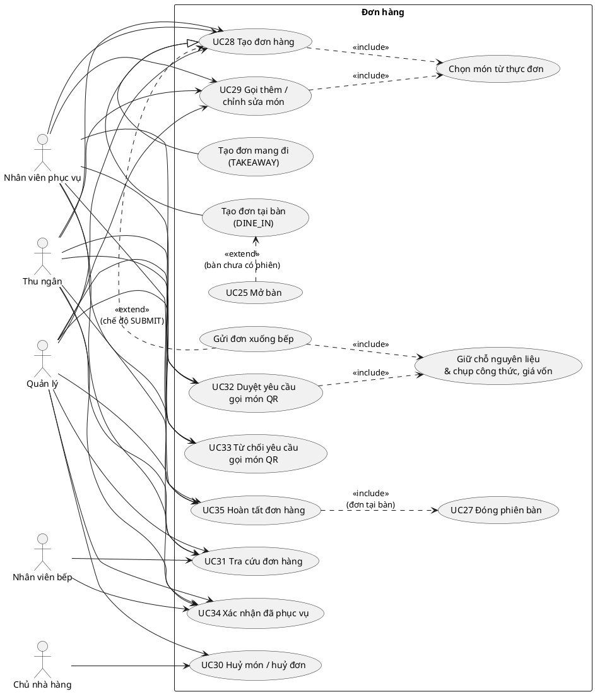
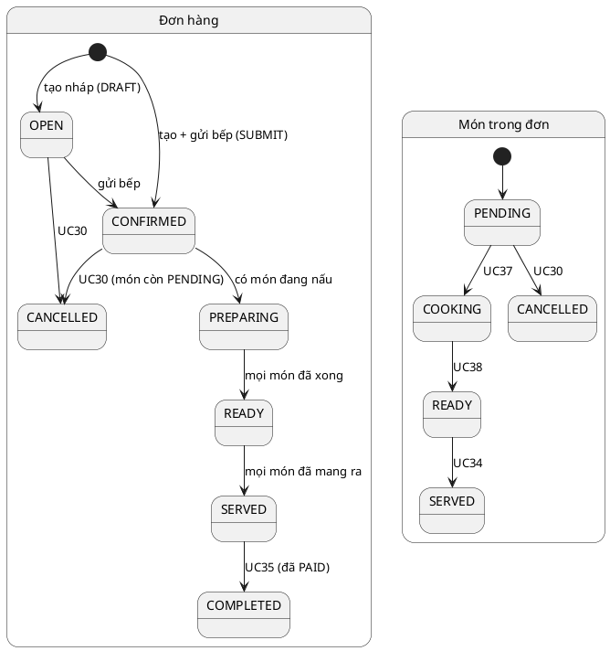

# Nhóm 6 – Gọi món & đơn hàng (UC28–UC35)

## Sơ đồ Use Case

### Biểu đồ trạng thái đơn hàng và món

---

## UC28 – Tạo đơn hàng

| Thuộc tính | Nội dung |
|---|---|
| **Actor chính** | Nhân viên phục vụ, Thu ngân, Quản lý, Chủ nhà hàng |
| **Mô tả** | Lập đơn gọi món cho khách **tại bàn** (DINE_IN – gắn phiên bàn) hoặc **mang đi** (TAKEAWAY – có tên/SĐT khách). Đơn có thể lưu nháp hoặc gửi thẳng xuống bếp. |
| **Tiền điều kiện** | ĐK-A; ĐK-G(`ORDER_MANAGEMENT`, thêm `TABLE_MANAGEMENT` cho tại bàn hoặc `POS_QUICK_ORDER` cho mang đi); ĐK-P(`ORDER_CREATE`; gửi bếp thêm `ORDER_UPDATE`; tự mở phiên thêm `TABLE_OPEN`). |
| **Hậu điều kiện** | Đơn được tạo với mã đơn, giá bán được chụp vào từng dòng, tổng tiền tính ở server. Nếu SUBMIT: đơn `CONFIRMED`, các món `PENDING` xuất hiện ở màn hình bếp, nguyên liệu được giữ chỗ, công thức/giá vốn được chụp; ghi nhật ký `ORDER_CREATED`/`ORDER_CONFIRMED`; phát realtime. |

**Luồng chính (tại bàn, gửi bếp ngay)**
1. Actor chọn bàn trên sơ đồ bàn (bàn đang phục vụ hoặc bàn trống).
2. Hệ thống hiển thị thực đơn theo nhóm (chỉ món đang bán, còn hàng) – include “Chọn món”.
3. Actor chọn món, số lượng, ghi chú từng món (ví dụ “ít cay”), số khách, ghi chú đơn.
4. Actor nhấn “Gửi bếp” (chế độ SUBMIT). Client gửi kèm `Idempotency-Key`.
5. Hệ thống kiểm tra:
   - bàn/phiên hợp lệ; nếu bàn chưa có phiên → **tự mở phiên** (extend UC25, cần `TABLE_OPEN`);
   - phiên chưa có đơn đang phục vụ (mỗi phiên tối đa một đơn đang phục vụ);
   - món tồn tại, đang bán, còn hàng; số lượng hợp lệ; tổng tiền không vượt giới hạn.
6. Hệ thống tạo đơn, chụp giá, tính tổng tiền, sinh mã đơn.
7. Hệ thống xác nhận đơn (include “Gửi đơn xuống bếp”): chụp công thức & giá vốn tham chiếu, **giữ chỗ nguyên liệu** trong kho mặc định (nếu gói có kho).
8. Hệ thống phát sự kiện realtime tới màn hình bếp và các thiết bị nhân viên; trả về đơn.

**Luồng thay thế**
- 1a. Mang đi: actor chọn “Đơn mang đi”, nhập tên/SĐT khách → bỏ qua bước chọn bàn.
- 4a. Lưu nháp (DRAFT): đơn ở `OPEN`, chưa gửi bếp, chưa giữ kho; có thể sửa tự do và gửi bếp sau (UC29 – “Gửi bếp”).
- 5a. Phiên đã có đơn đang phục vụ → `409 TABLE_SESSION_HAS_SERVING_ORDER`; client mở đơn hiện tại (lấy “đơn đang phục vụ của phiên”) và chuyển sang **gọi thêm** (UC29).

**Ngoại lệ**
- 5b. Đơn rỗng → `400 EMPTY_ORDER`.
- 5c. Tại bàn nhưng không chỉ định bàn/phiên, hoặc chỉ định cả hai → `DINE_IN_SESSION_REQUIRED` / `AMBIGUOUS_ORDER_SEATING`; tạo theo bàn nhưng ở chế độ nháp → `TABLE_ORDER_REQUIRES_SUBMIT`.
- 5d. Đơn mang đi gắn bàn/phiên → `TAKEAWAY_TABLE_NOT_ALLOWED` / `TAKEAWAY_SESSION_NOT_ALLOWED`.
- 5e. Món ngừng bán / tạm hết → `ITEM_NOT_SELLABLE` / `ITEM_OUT_OF_STOCK`.
- 5f. Bàn đã có khách khác mở phiên trong lúc thao tác → `TABLE_ALREADY_OCCUPIED`.
- 7a. Thiếu tồn khả dụng của nguyên liệu hoặc chưa có kho mặc định → `409` (kèm chi tiết nguyên liệu thiếu / `INVENTORY_DEFAULT_WAREHOUSE_REQUIRED`); **toàn bộ thao tác bị huỷ**, đơn không được tạo.
- E7 – mất mạng gửi lại → trả lại đơn đã tạo, không tạo trùng.

**Quy tắc nghiệp vụ**
- BR28-1: Server tự tính giá, tổng tiền; không nhận số tiền/trạng thái từ client.
- BR28-2: Mỗi phiên bàn tối đa **một** đơn đang phục vụ (`OPEN`…`SERVED`).

---

## UC29 – Gọi thêm / chỉnh sửa món

| Thuộc tính | Nội dung |
|---|---|
| **Actor chính** | Nhân viên phục vụ, Thu ngân, Quản lý, Chủ nhà hàng |
| **Mô tả** | Thêm món vào đơn đang phục vụ; sửa số lượng/ghi chú món chưa chế biến; sửa thông tin đơn nháp (số khách, ghi chú, khách hàng); gửi đơn nháp xuống bếp. |
| **Tiền điều kiện** | ĐK-A; ĐK-G(`ORDER_MANAGEMENT`); ĐK-P(`ORDER_UPDATE`). Đơn **chưa thanh toán**, chưa hoàn tất/huỷ. |
| **Hậu điều kiện** | Đơn được cập nhật, tổng tiền tính lại, phiên bản tăng; món mới (nếu SUBMIT) xuất hiện ở bếp và được giữ kho; ghi nhật ký `ORDER_ITEMS_ADDED` / `ORDER_ITEM_UPDATED` / `ORDER_UPDATED` / `ORDER_CONFIRMED`. |

**Luồng chính – Gọi thêm**
1. Actor mở đơn đang phục vụ của bàn.
2. Actor chọn “Gọi thêm”, chọn món & số lượng (include “Chọn món”), nhấn “Gửi bếp”.
3. Hệ thống kiểm tra phiên bản đơn, đơn chưa thanh toán, món hợp lệ.
4. Hệ thống thêm dòng mới (`PENDING`), chụp giá/công thức, giữ chỗ nguyên liệu, tính lại tổng tiền.
5. Hệ thống phát realtime tới bếp; trả đơn mới.

**Luồng thay thế**
- 2a. Sửa dòng món: chỉ được sửa dòng ở trạng thái `PENDING` (chưa nấu) – đổi số lượng/ghi chú.
- 2b. Sửa thông tin đơn: chỉ khi đơn còn `OPEN` (nháp).
- 2c. Gửi bếp đơn nháp: “Xác nhận đơn” → đơn `CONFIRMED`, các món vào hàng chờ bếp (như bước 7 UC28).

**Ngoại lệ**
- 3a. Đơn đã thanh toán → `409 ORDER_HAS_FINANCIAL_OBLIGATIONS` (khách muốn gọi thêm thì tạo đơn mới sau khi hoàn tất).
- 2a-a. Món đã bắt đầu nấu → `409 ORDER_ITEM_NOT_EDITABLE`.
- 2b-a. Đơn không còn nháp → `409 ORDER_NOT_EDITABLE`.
- E6 → `409 CONCURRENT_ORDER_UPDATE`; 4a. thiếu tồn → như UC28-7a.

---

## UC30 – Huỷ món / huỷ đơn

| Thuộc tính | Nội dung |
|---|---|
| **Actor chính** | Quản lý, Chủ nhà hàng (`ORDER_CANCEL`); Phục vụ/Thu ngân chỉ huỷ món của đơn **chưa gửi bếp** (`ORDER_UPDATE`) |
| **Mô tả** | Huỷ một món chưa chế biến hoặc huỷ toàn bộ đơn (khách đổi ý, nhập nhầm). |
| **Tiền điều kiện** | ĐK-A; ĐK-G(`ORDER_MANAGEMENT`). Đơn chưa thanh toán, chưa hoàn tất. |
| **Hậu điều kiện** | Món/đơn chuyển `CANCELLED`, tổng tiền tính lại, **giải phóng nguyên liệu đã giữ chỗ**, món biến mất khỏi màn hình bếp; ghi nhật ký `ORDER_ITEM_CANCELLED` / `ORDER_CANCELLED` kèm lý do. |

**Luồng chính – Huỷ món**
1. Actor mở đơn, chọn dòng món → “Huỷ món”, nhập lý do.
2. Hệ thống kiểm tra quyền: đơn chưa gửi bếp cần `ORDER_UPDATE`, đơn đã gửi bếp cần `ORDER_CANCEL`.
3. Hệ thống kiểm tra món đang `PENDING`, đơn chưa thanh toán.
4. Hệ thống huỷ món, giải phóng giữ chỗ kho, tính lại tổng, phát realtime.

**Luồng thay thế – Huỷ đơn**
- 1a. Actor chọn “Huỷ đơn”, nhập lý do → hệ thống kiểm tra đơn ở `OPEN`/`CONFIRMED`, mọi món còn `PENDING`, chưa thanh toán → huỷ toàn bộ đơn và các món.

**Ngoại lệ**
- 3a. Món đã nấu/đã xong → `409 ORDER_ITEM_NOT_EDITABLE`.
- 3b. Đơn đã thanh toán → `409 ORDER_HAS_FINANCIAL_OBLIGATIONS`.
- 1a-a. Đơn đã chuyển sang chế biến/hoàn tất → `409 INVALID_ORDER_TRANSITION`.

---

## UC31 – Tra cứu đơn hàng

| Thuộc tính | Nội dung |
|---|---|
| **Actor chính** | Nhân viên nhà hàng (có `ORDER_VIEW`) |
| **Mô tả** | Xem danh sách đơn (lọc theo trạng thái, trạng thái thanh toán, loại phục vụ, bàn/phiên, khoảng thời gian, mã đơn) và xem chi tiết đơn (các món, trạng thái món, tiền, lịch sử). |
| **Tiền điều kiện** | ĐK-A; ĐK-G(`ORDER_MANAGEMENT`); ĐK-P(`ORDER_VIEW`). |
| **Hậu điều kiện** | Không thay đổi dữ liệu. |

**Luồng chính**
1. Actor mở “Đơn hàng”, chọn bộ lọc.
2. Hệ thống trả danh sách đơn phân trang.
3. Actor chọn một đơn → hệ thống trả chi tiết đơn.

**Luồng thay thế**
- 3a. Có thêm `RECIPE_VIEW`: xem snapshot công thức của từng món.
- 3b. Có thêm `REPORT_DETAIL_VIEW`: xem snapshot giá vốn của từng món.
- 3c. Có thêm `INVENTORY_VIEW`: xem tình trạng giữ chỗ/trừ kho của từng món.
- 1a. Từ sơ đồ bàn: lấy “đơn đang phục vụ” của phiên bàn.

---

## UC32 – Duyệt yêu cầu gọi món QR

| Thuộc tính | Nội dung |
|---|---|
| **Actor chính** | Nhân viên phục vụ, Thu ngân, Quản lý, Chủ nhà hàng |
| **Mô tả** | Khi thực khách gửi yêu cầu gọi món qua QR (UC43), yêu cầu ở trạng thái **chờ duyệt**; nhân viên kiểm tra rồi duyệt để chuyển thành đơn thật. |
| **Tiền điều kiện** | ĐK-A; ĐK-G(`ORDER_MANAGEMENT` + `QR_TABLE_ORDER`/`QR_STATIC_ORDER`); ĐK-P(`ORDER_CREATE` và `ORDER_UPDATE`; mở phiên mới thêm `TABLE_OPEN`). Yêu cầu `PENDING`, chưa hết hạn. |
| **Hậu điều kiện** | Yêu cầu `APPROVED` gắn với đơn. QR tại bàn: mở phiên nếu chưa có, tạo đơn mới hoặc **gọi thêm** vào đơn đang phục vụ của phiên. QR mang đi: tạo một đơn TAKEAWAY độc lập. Món vào hàng chờ bếp, giữ kho, chụp công thức/giá vốn; ghi nhật ký `QR_ORDER_REQUEST_APPROVED`. |

**Luồng chính**
1. Hệ thống đẩy thông báo realtime “Có yêu cầu gọi món mới” tới thiết bị nhân viên.
2. Actor mở danh sách yêu cầu QR (lọc theo trạng thái/bàn), chọn một yêu cầu.
3. Hệ thống hiển thị chi tiết: bàn (hoặc tên/SĐT khách mang đi), món, số lượng, ghi chú, tổng tạm tính, phiên/đơn sẽ được gắn.
4. Actor kiểm tra và nhấn “Duyệt”.
5. Hệ thống kiểm tra lại: yêu cầu còn `PENDING`, chưa hết hạn, QR bàn chưa bị tạo lại, ngữ cảnh duyệt (phiên/đơn đích) không thay đổi so với lúc xem, món còn bán, gói còn tính năng QR.
6. Hệ thống tạo/gọi thêm đơn như UC28/UC29 ở chế độ gửi bếp, gắn yêu cầu với đơn.
7. Hệ thống phát realtime tới bếp; thực khách thấy trạng thái “Đã xác nhận” (UC44).

**Ngoại lệ**
- 5a. Yêu cầu đã được người khác duyệt/từ chối → `409 INVALID_QR_REQUEST_TRANSITION` / `CONCURRENT_QR_REQUEST_UPDATE`.
- 5b. Hết hạn → `QR_ORDER_REQUEST_EXPIRED`.
- 5c. Phiên/đơn của bàn đã thay đổi kể từ lúc xem (ví dụ vừa thanh toán, chuyển bàn) → `409 QR_REVIEW_CONTEXT_CHANGED` / `QR_REQUEST_SESSION_CHANGED`; actor tải lại và xem lại.
- 5d. Bàn đang thanh toán → `QR_ORDER_CHECKOUT_IN_PROGRESS`.
- 6a. Thiếu tồn nguyên liệu → `409`; yêu cầu **vẫn giữ `PENDING`**, có thể duyệt lại sau khi nhập kho.

---

## UC33 – Từ chối yêu cầu gọi món QR

| Thuộc tính | Nội dung |
|---|---|
| **Actor chính** | Nhân viên phục vụ, Thu ngân, Quản lý, Chủ nhà hàng |
| **Mô tả** | Từ chối yêu cầu gọi món QR không hợp lệ (gọi nhầm bàn, spam, món đã hết…). |
| **Tiền điều kiện** | ĐK-A; ĐK-P(`ORDER_UPDATE`). Yêu cầu `PENDING`. |
| **Hậu điều kiện** | Yêu cầu `REJECTED` kèm lý do; không tạo đơn, không giữ kho; ghi nhật ký `QR_ORDER_REQUEST_REJECTED`. |

**Luồng chính**
1. Actor mở chi tiết yêu cầu (như UC32 bước 2–3), chọn “Từ chối”.
2. Actor nhập lý do (bắt buộc) và xác nhận.
3. Hệ thống kiểm tra yêu cầu còn `PENDING`, cập nhật `REJECTED`, phát realtime.
4. Thực khách thấy “Yêu cầu bị từ chối” kèm lý do (UC44).

**Ngoại lệ**
- 2a. Không nhập lý do → `400 VALIDATION_ERROR`.
- 3a. Yêu cầu đã được xử lý → `409 INVALID_QR_REQUEST_TRANSITION`.

---

## UC34 – Xác nhận đã phục vụ

| Thuộc tính | Nội dung |
|---|---|
| **Actor chính** | Nhân viên phục vụ, Thu ngân, Nhân viên bếp, Quản lý, Chủ nhà hàng |
| **Mô tả** | Đánh dấu một món, hoặc tất cả món đã xong của một đơn, **đã mang ra cho khách**. |
| **Tiền điều kiện** | ĐK-A; ĐK-G(`ORDER_MANAGEMENT`); ĐK-P(`ORDER_MARK_SERVED`). Món ở trạng thái `READY`. |
| **Hậu điều kiện** | Món `SERVED`; nếu mọi món còn sống đã `SERVED` thì đơn chuyển `SERVED`; ghi nhật ký `ORDER_ITEMS_MARKED_SERVED`; phát realtime. |

**Luồng chính**
1. Hệ thống thông báo realtime món đã xong (từ UC38).
2. Actor mang món ra, chọn món trên đơn → “Đã phục vụ” (hoặc “Phục vụ tất cả” cho cả đơn).
3. Hệ thống kiểm tra món đang `READY`, phiên bản đơn đúng.
4. Hệ thống cập nhật trạng thái món/đơn, phát realtime.

**Luồng thay thế**
- 2a. “Phục vụ tất cả”: hệ thống chuyển **nguyên tử** mọi món chưa huỷ, chưa phục vụ của đơn sang `SERVED` (dùng cho quán phục vụ nhanh, không qua màn hình bếp).

**Ngoại lệ**
- 3a. Món chưa xong / đã huỷ → `409 INVALID_ORDER_ITEM_TRANSITION`.
- 3b. Gửi lặp (đã `SERVED`) → trả thành công, không ghi lịch sử mới.

---

## UC35 – Hoàn tất đơn hàng

| Thuộc tính | Nội dung |
|---|---|
| **Actor chính** | Nhân viên phục vụ, Thu ngân, Quản lý, Chủ nhà hàng |
| **Mô tả** | Kết thúc đơn khi khách đã thanh toán đủ và đã nhận đủ món. Với đơn tại bàn, đồng thời **đóng phiên bàn** để bàn trở về trống. |
| **Tiền điều kiện** | ĐK-A; ĐK-G(`ORDER_MANAGEMENT`); ĐK-P(`ORDER_COMPLETE`; đơn tại bàn thêm `TABLE_CLOSE`). Đơn `PAID`; mọi món chưa huỷ đều `SERVED`. |
| **Hậu điều kiện** | Đơn `COMPLETED`; đơn tại bàn: phiên `CLOSED` trong **cùng giao dịch**; ghi nhật ký `ORDER_COMPLETED` (+ `TABLE_SESSION_CLOSED`); phát realtime. |

**Luồng chính**
1. Sau khi thanh toán (UC39), actor nhấn “Hoàn tất đơn”.
2. Hệ thống kiểm tra: đơn đã thanh toán đủ, mọi món chưa huỷ đã phục vụ, không còn nguyên liệu bị giữ chỗ bỏ quên, phiên bản đơn đúng.
3. Hệ thống chuyển đơn `COMPLETED`.
4. Nếu đơn tại bàn và mọi đơn của phiên đã đủ điều kiện → đóng phiên bàn (include UC27).
5. Hệ thống phát realtime; sơ đồ bàn hiển thị bàn trống.

**Ngoại lệ**
- 2a. Chưa thanh toán → `409 ORDER_NOT_PAID`.
- 2b. Còn món chưa phục vụ → `409 ORDER_NOT_READY_FOR_COMPLETION`.
- 2c. Gửi lặp khi đơn đã `COMPLETED` và phiên đã `CLOSED` → trả thành công (không thay đổi gì).
