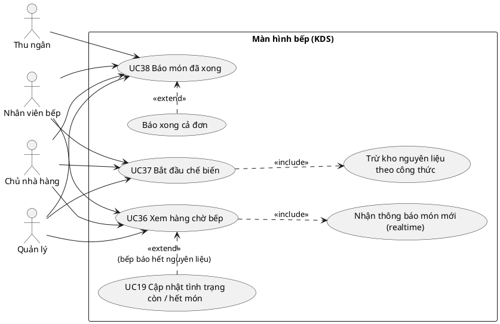

# Nhóm 7 – Màn hình bếp – KDS (UC36–UC38)

## Sơ đồ Use Case

---

## UC36 – Xem hàng chờ bếp

| Thuộc tính | Nội dung |
|---|---|
| **Actor chính** | Nhân viên bếp, Quản lý, Chủ nhà hàng |
| **Mô tả** | Màn hình bếp hiển thị các món cần chế biến theo thứ tự gửi bếp, kèm bàn/mã đơn, số lượng, ghi chú; tự cập nhật khi có món mới hoặc món bị huỷ. |
| **Tiền điều kiện** | ĐK-A; ĐK-G(`KITCHEN_DISPLAY`); ĐK-P(`KITCHEN_VIEW`). |
| **Hậu điều kiện** | Không thay đổi dữ liệu. |

**Luồng chính**
1. Actor mở màn hình bếp.
2. Hệ thống trả danh sách món ở trạng thái `PENDING`, `COOKING` (và `READY` chưa mang ra) – sắp xếp theo thời điểm gửi bếp, lọc được theo trạng thái/nhóm món.
3. Client kết nối kênh realtime (WebSocket STOMP) của nhà hàng (include).
4. Khi có sự kiện đơn mới, gọi thêm, huỷ món, duyệt QR… hệ thống đẩy thông báo; client tải lại hàng chờ.

**Luồng thay thế**
- 4a. Mất kết nối realtime → client tự kết nối lại và tải lại toàn bộ hàng chờ.
- 4b. (Extend) Bếp hết nguyên liệu cho một món → bếp (nếu được cấp quyền) đánh dấu món “Tạm hết” (UC19).

---

## UC37 – Bắt đầu chế biến

| Thuộc tính | Nội dung |
|---|---|
| **Actor chính** | Nhân viên bếp, Quản lý, Chủ nhà hàng |
| **Mô tả** | Đánh dấu món chuyển sang “Đang nấu”. Nguyên liệu đã giữ chỗ được **trừ thật** khỏi kho. |
| **Tiền điều kiện** | ĐK-A; ĐK-G(`KITCHEN_DISPLAY`); ĐK-P(`KITCHEN_START_COOKING`). Món ở trạng thái `PENDING`. |
| **Hậu điều kiện** | Món `COOKING`; đơn chuyển `PREPARING`; ghi giao dịch kho `RECIPE_USE` (hoặc `DIRECT_USE` với món bán trực tiếp từ kho), giữ chỗ chuyển `CONSUMED`; cập nhật cảnh báo tồn thấp nếu cần; ghi nhật ký; phát realtime. Món không còn huỷ được. |

**Luồng chính**
1. Actor chọn món trên màn hình bếp → “Bắt đầu nấu”.
2. Hệ thống kiểm tra món `PENDING`, phiên bản đơn đúng.
3. Hệ thống chuyển món sang `COOKING` và cập nhật trạng thái đơn.
4. Hệ thống trừ tồn kho theo snapshot công thức (include), ghi sổ giao dịch kho.
5. Nếu tồn sau khi trừ dưới ngưỡng tối thiểu → tạo/cập nhật cảnh báo sắp hết hàng (UC49).
6. Hệ thống phát realtime cho nhân viên.

**Ngoại lệ**
- 2a. Món đã bị huỷ hoặc đã nấu → `409 INVALID_ORDER_ITEM_TRANSITION`.
- E6 → `409 CONCURRENT_ORDER_UPDATE`.

---

## UC38 – Báo món đã xong

| Thuộc tính | Nội dung |
|---|---|
| **Actor chính** | Nhân viên bếp, Thu ngân, Quản lý, Chủ nhà hàng |
| **Mô tả** | Đánh dấu một món, hoặc toàn bộ món của một đơn (extend “Báo xong cả đơn”), đã nấu xong, chờ mang ra. |
| **Tiền điều kiện** | ĐK-A; ĐK-G(`KITCHEN_DISPLAY`); ĐK-P(`KITCHEN_MARK_READY`). Món ở `PENDING` hoặc `COOKING`. |
| **Hậu điều kiện** | Món `READY`; nếu mọi món còn sống của đơn đã xong → đơn `READY`; ghi nhật ký `ORDER_ITEMS_MARKED_READY`; phát realtime để phục vụ mang món ra (UC34). |

**Luồng chính**
1. Actor chọn món đang nấu → “Xong”.
2. Hệ thống kiểm tra món đang `COOKING` (luồng `PENDING → COOKING → READY`).
3. Hệ thống cập nhật món/đơn, phát realtime.

**Luồng thay thế**
- 1a. Báo xong cả đơn: actor chọn đơn → “Xong tất cả” → hệ thống cập nhật **nguyên tử** mọi món `PENDING`/`COOKING` của đơn sang `READY`; món còn `PENDING` được bỏ qua bước nấu và **trừ kho** như UC37.

**Ngoại lệ**
- 2a. Món đã huỷ/đã phục vụ → `409 INVALID_ORDER_ITEM_TRANSITION`.
- 2b. Gửi lặp → không tạo lịch sử mới.
