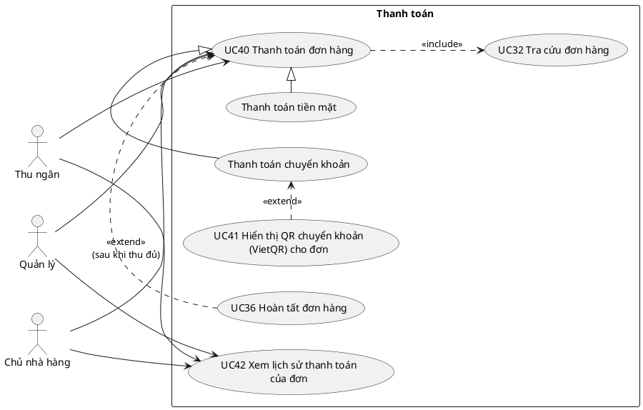

# Nhóm 8 – Thanh toán đơn hàng (UC40–UC42)

## Sơ đồ Use Case

---

## UC40 – Thanh toán đơn hàng

| Thuộc tính | Nội dung |
|---|---|
| **Actor chính** | Thu ngân, Quản lý, Chủ nhà hàng |
| **Mô tả** | Ghi nhận khách đã trả **đủ** tiền cho đơn bằng tiền mặt hoặc chuyển khoản (nhân viên tự kiểm tra tài khoản ngân hàng và xác nhận). |
| **Tiền điều kiện** | ĐK-A; ĐK-G(`PAYMENT_MANAGEMENT`); ĐK-P(`PAYMENT_CREATE` và `PAYMENT_CONFIRM`). Đơn ở `CONFIRMED`/`PREPARING`/`READY`/`SERVED`, chưa thanh toán, tổng tiền > 0. |
| **Hậu điều kiện** | Tạo bản ghi thanh toán `SUCCESS`; đơn `paymentStatus = PAID`, `paidAmount = totalAmount`; các yêu cầu QR đang chờ của phiên bàn bị huỷ (lý do “bắt đầu thanh toán”); khoản thu được tính vào doanh thu và sổ thu chi; ghi nhật ký `PAYMENT_RECORDED`; phát realtime. **Trạng thái đơn và phiên bàn không đổi** (hoàn tất ở UC36). |

**Luồng chính**
1. Actor mở đơn cần thanh toán (include UC32), hệ thống hiển thị chi tiết món và tổng tiền.
2. Actor chọn “Thanh toán”, chọn phương thức:
   - **Tiền mặt**: nhập số tiền khách đưa (client tự tính tiền thừa);
   - **Chuyển khoản**: (extend UC41) hiển thị QR cho khách quét; sau khi kiểm tra tài khoản đã nhận tiền, nhập mã tham chiếu giao dịch.
3. Actor nhấn “Xác nhận đã thu tiền”. Client gửi số tiền, phương thức, phiên bản đơn, `Idempotency-Key`.
4. Hệ thống kiểm tra trạng thái đơn, phiên bản đơn, số tiền **bằng đúng** tổng tiền đơn.
5. Hệ thống ghi thanh toán, cập nhật đơn `PAID`, huỷ yêu cầu QR chờ của bàn – trong một giao dịch.
6. Hệ thống trả kết quả; client in hoá đơn (nếu gói có tính năng in) và gợi ý “Hoàn tất đơn” (UC36).

**Ngoại lệ**
- 4a. Số tiền khác tổng tiền đơn → `400/409 PAYMENT_AMOUNT_MISMATCH` (không hỗ trợ trả một phần / chia bill).
- 4b. Đơn nháp, đã huỷ, đã hoàn tất → `409 ORDER_NOT_PAYABLE`.
- 4c. Đơn đã thanh toán → `409 ORDER_ALREADY_PAID`.
- 4d. Chuyển khoản thiếu mã tham chiếu → `400 TRANSFER_REFERENCE_REQUIRED`; phương thức khác CASH/TRANSFER → `UNSUPPORTED_PAYMENT_METHOD`.
- 4e. Đơn vừa bị gọi thêm món (phiên bản thay đổi) → `409 CONCURRENT_ORDER_UPDATE`; actor tải lại để thu đúng số tiền mới.
- E7 – bấm lặp / mất mạng gửi lại → trả lại thanh toán cũ (`Idempotency-Replayed: true`), không thu hai lần; khác nội dung → `409 PAYMENT_IDEMPOTENCY_KEY_REUSED`.

**Quy tắc nghiệp vụ**
- BR40-1: Chỉ thanh toán đủ một lần; chưa hỗ trợ hoàn tiền, chia hoá đơn, thanh toán online tự động cho đơn món ăn.
- BR40-2: Có thể thanh toán trước hoặc sau khi phục vụ. Sau khi `PAID`, đơn không gọi thêm/huỷ món được nữa.

---

## UC41 – Hiển thị QR chuyển khoản (VietQR) cho đơn

| Thuộc tính | Nội dung |
|---|---|
| **Actor chính** | Thu ngân, Quản lý, Chủ nhà hàng |
| **Mô tả** | Sinh mã VietQR theo chuẩn NAPAS chứa tài khoản nhận của nhà hàng (UC06), số tiền đúng bằng tổng đơn và nội dung là mã đơn, để khách quét bằng app ngân hàng. |
| **Tiền điều kiện** | ĐK-A; ĐK-G(`PAYMENT_MANAGEMENT`); ĐK-P(`PAYMENT_CREATE`). Nhà hàng đã cấu hình tài khoản nhận; tiền tệ VND. |
| **Hậu điều kiện** | Không thay đổi dữ liệu. |

**Luồng chính**
1. Ở bước chọn phương thức của UC40, actor chọn “Chuyển khoản”.
2. Hệ thống lấy tài khoản nhận của nhà hàng và tổng tiền đơn, dựng chuỗi VietQR (ngân hàng, số tài khoản, số tiền, nội dung).
3. Hệ thống trả thông tin chuyển khoản và ảnh QR (PNG/SVG); màn hình hiển thị cho khách quét.
4. Khách chuyển khoản; thu ngân kiểm tra biến động số dư rồi quay về UC40 bước 3.

**Ngoại lệ**
- 2a. Chưa cấu hình tài khoản nhận → `TRANSFER_ACCOUNT_NOT_CONFIGURED`; gợi ý chủ nhà hàng cấu hình (UC06) hoặc thu tiền mặt.
- 2b. Tiền tệ không phải VND → `TRANSFER_QR_CURRENCY_UNSUPPORTED`.

---

## UC42 – Xem lịch sử thanh toán của đơn

| Thuộc tính | Nội dung |
|---|---|
| **Actor chính** | Thu ngân, Quản lý, Chủ nhà hàng |
| **Mô tả** | Xem các lần thanh toán của một đơn: phương thức, số tiền, mã tham chiếu, người thu, thời điểm. |
| **Tiền điều kiện** | ĐK-A; ĐK-G(`PAYMENT_MANAGEMENT`); ĐK-P(`PAYMENT_VIEW`). |
| **Hậu điều kiện** | Không thay đổi dữ liệu. |

**Luồng chính**
1. Actor mở chi tiết đơn → tab “Thanh toán”.
2. Hệ thống trả danh sách thanh toán (phân trang).
3. Actor chọn một thanh toán → hệ thống trả chi tiết.

**Ngoại lệ**
- 3a. Thanh toán không thuộc đơn/nhà hàng → `404 PAYMENT_NOT_FOUND`.
