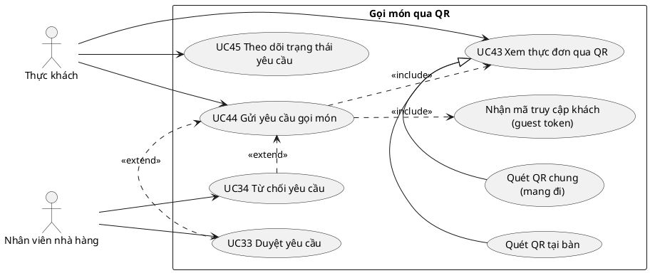
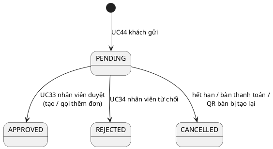

# Nhóm 9 – Thực khách gọi món qua QR (UC43–UC45)

## Sơ đồ Use Case

### Biểu đồ trạng thái yêu cầu gọi món QR

---

## UC43 – Xem thực đơn qua QR

| Thuộc tính | Nội dung |
|---|---|
| **Actor chính** | Thực khách |
| **Mô tả** | Khách quét QR dán trên bàn (gọi tại bàn) hoặc QR chung của nhà hàng (mang đi) để xem thực đơn trên điện thoại, không cần đăng nhập. |
| **Tiền điều kiện** | QR hợp lệ (bàn/link chưa bị tạo lại); nhà hàng `ACTIVE` và gói hiệu lực có tính năng xem thực đơn QR. |
| **Hậu điều kiện** | Không thay đổi dữ liệu. |

**Luồng chính**
1. Khách quét QR bằng camera điện thoại; trình duyệt mở trang thực đơn với token trong đường dẫn.
2. Hệ thống xác định nhà hàng (và bàn nếu là QR bàn) từ token.
3. Hệ thống trả thông tin nhà hàng, bàn, danh sách nhóm món.
4. Khách chọn nhóm / tìm kiếm → hệ thống trả danh sách món đang bán: tên, ảnh, mô tả, giá, tình trạng còn/hết (không bao gồm giá vốn, công thức).

**Ngoại lệ**
- 2a. Token không tồn tại / QR đã bị tạo lại → `404 QR_MENU_NOT_FOUND` / `PUBLIC_MENU_NOT_FOUND`: “Mã QR không còn hiệu lực, vui lòng liên hệ nhân viên”.
- 2b. Bàn bị tắt, nhà hàng bị khoá hoặc gói hết hạn → `QR_MENU_UNAVAILABLE` / `PUBLIC_MENU_UNAVAILABLE`.

---

## UC44 – Gửi yêu cầu gọi món qua QR

| Thuộc tính | Nội dung |
|---|---|
| **Actor chính** | Thực khách |
| **Actor phụ** | Nhân viên nhà hàng (nhận thông báo, xử lý ở UC33/UC34) |
| **Mô tả** | Khách chọn món vào giỏ và gửi yêu cầu. Yêu cầu **chưa phải đơn**: không mở bàn, không gửi bếp, không tính tiền cho đến khi nhân viên duyệt. |
| **Tiền điều kiện** | Đang ở trang thực đơn QR (UC43). Gói có `QR_TABLE_ORDER` (tại bàn) hoặc `QR_STATIC_ORDER` (mang đi). |
| **Hậu điều kiện** | Tạo yêu cầu `PENDING` có thời hạn; nhân viên nhận thông báo realtime; ghi nhật ký `QR_ORDER_REQUEST_CREATED`. |

**Luồng chính**
1. Khách thêm món vào giỏ, chỉnh số lượng, ghi chú từng món.
2. Khi gửi lần đầu, client xin **mã truy cập khách** (include): hệ thống kiểm tra QR và cấp guest token ngắn hạn gắn với bàn/nhà hàng (gửi trong header, không đặt trên URL).
3. Khách nhấn “Gửi yêu cầu”; với mang đi phải nhập **tên người nhận** (SĐT tuỳ chọn). Client gửi kèm `Idempotency-Key`.
4. Hệ thống kiểm tra guest token, giới hạn tần suất, kích thước yêu cầu, món còn bán, gói còn tính năng QR.
5. Hệ thống tính tạm tính, lưu yêu cầu `PENDING`, ghi nhận phiên bàn đang mở (nếu có).
6. Hệ thống đẩy thông báo realtime tới nhân viên; trả mã yêu cầu cho khách và chuyển sang màn hình theo dõi (UC45).

**Ngoại lệ**
- 2a. Token QR không hợp lệ / hết hạn → `QR_GUEST_ACCESS_INVALID`; client xin lại token.
- 4a. Gửi quá nhiều yêu cầu → `429 QR_RATE_LIMIT_EXCEEDED`.
- 4b. Nội dung quá lớn → `413 QR_REQUEST_BODY_TOO_LARGE`.
- 4c. Tính năng gọi món QR không có trong gói / bàn tắt → `QR_ORDER_UNAVAILABLE`.
- 4d. Món ngừng bán / hết → `ITEM_NOT_SELLABLE` / `ITEM_OUT_OF_STOCK`.
- 4e. Bàn đang thanh toán → `QR_ORDER_CHECKOUT_IN_PROGRESS`.
- E7 – gửi lặp cùng key → trả lại yêu cầu cũ.

**Quy tắc nghiệp vụ**
- BR44-1: Guest token không dùng được cho bất kỳ API nội bộ nào (đơn, bàn, thanh toán).
- BR44-2: Khách không thấy thông tin của khách khác hoặc giá vốn/kho.

---

## UC45 – Theo dõi trạng thái yêu cầu gọi món

| Thuộc tính | Nội dung |
|---|---|
| **Actor chính** | Thực khách |
| **Mô tả** | Khách xem yêu cầu của mình đang chờ duyệt, đã được xác nhận (kèm mã đơn), bị từ chối (kèm lý do) hay đã huỷ/hết hạn. |
| **Tiền điều kiện** | Đã gửi yêu cầu (UC44) và còn giữ guest token. |
| **Hậu điều kiện** | Không thay đổi dữ liệu. |

**Luồng chính**
1. Màn hình theo dõi định kỳ gửi yêu cầu lấy trạng thái theo mã yêu cầu (kèm guest token).
2. Hệ thống kiểm tra yêu cầu thuộc đúng khách đó, trả trạng thái hiện tại.
3. Client hiển thị: “Đang chờ nhân viên xác nhận” / “Đã xác nhận – mã đơn …” / “Bị từ chối: lý do …” / “Đã huỷ / hết hạn”.

**Ngoại lệ**
- 2a. Yêu cầu không thuộc khách / không tồn tại → `404 QR_ORDER_REQUEST_NOT_FOUND`.
- 2b. Guest token hết hạn → `QR_GUEST_ACCESS_INVALID`; khách quét lại QR.
