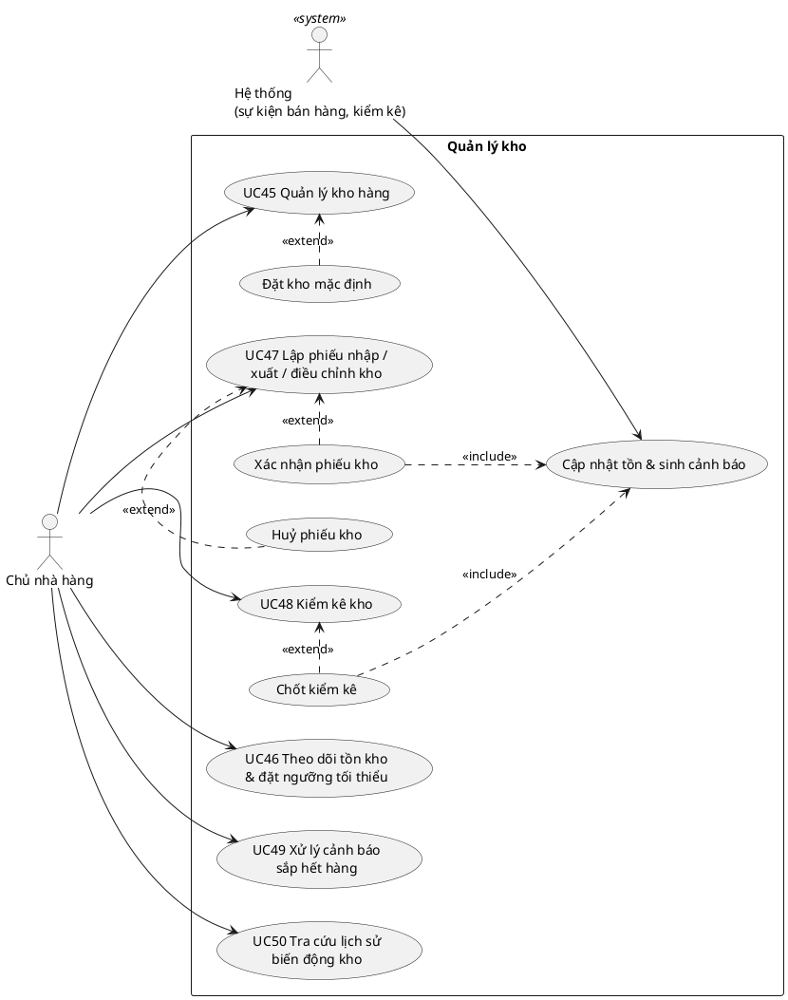
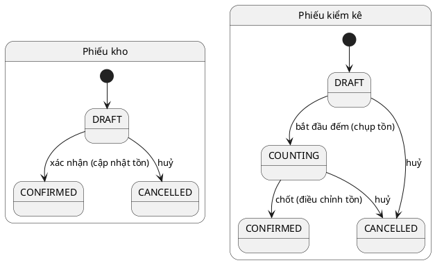

# Nhóm 10 – Quản lý kho (UC45–UC50)

## Sơ đồ Use Case

> Hệ thống không có vai trò “nhân viên kho” riêng: mặc định chỉ `OWNER` có quyền kho; chủ nhà hàng có thể cấp các quyền kho cho bất kỳ nhân viên nào (UC10).

### Biểu đồ trạng thái phiếu kho và phiếu kiểm kê

---

## UC45 – Quản lý kho hàng

| Thuộc tính | Nội dung |
|---|---|
| **Actor chính** | Chủ nhà hàng |
| **Mô tả** | Thêm, sửa, bật/tắt, xoá kho (kho bếp, kho quầy bar…) và chọn **kho mặc định** – kho dùng để giữ chỗ/trừ nguyên liệu khi bán hàng. |
| **Tiền điều kiện** | ĐK-A; ĐK-G(`INVENTORY_MANAGEMENT`); ĐK-P(`INVENTORY_VIEW` + `WAREHOUSE_CREATE`/`WAREHOUSE_UPDATE`/`WAREHOUSE_DELETE`). |
| **Hậu điều kiện** | Kho được lưu; ghi nhật ký `WAREHOUSE_CREATED`/`UPDATED`/`ENABLED`/`DISABLED`/`DEFAULT_CHANGED`/`DELETED`. |

**Luồng chính**
1. Actor mở “Kho → Danh sách kho”; hệ thống hiển thị các kho và kho mặc định.
2. Actor chọn “Thêm kho”, nhập mã kho, tên, địa chỉ/ghi chú.
3. Hệ thống kiểm tra mã chưa trùng và lưu (kho đầu tiên tự là kho mặc định).

**Luồng thay thế**
- 2a. Sửa kho; bật/tắt kho.
- 2b. (Extend) “Đặt làm kho mặc định”.
- 2c. Xoá kho (xác nhận).

**Ngoại lệ**
- 3a. Mã trùng → `409 WAREHOUSE_CODE_EXISTS`.
- 2a-a / 2c-a. Tắt/xoá kho mặc định → `DEFAULT_WAREHOUSE_CANNOT_BE_DISABLED` / `..._DELETED`.
- 2c-b. Kho còn tồn / còn giữ chỗ / đang kiểm kê → `WAREHOUSE_HAS_STOCK` / `WAREHOUSE_HAS_RESERVATIONS` / `WAREHOUSE_STOCK_AUDIT_IN_PROGRESS`.

---

## UC46 – Theo dõi tồn kho & đặt ngưỡng tối thiểu

| Thuộc tính | Nội dung |
|---|---|
| **Actor chính** | Chủ nhà hàng |
| **Mô tả** | Xem tồn từng nguyên liệu/hàng hoá theo kho: tồn vật lý, đang giữ chỗ cho đơn, khả dụng (= tồn − giữ chỗ), giá vốn bình quân; xem danh sách sắp hết; đặt ngưỡng tồn tối thiểu. |
| **Tiền điều kiện** | ĐK-A; ĐK-G(`INVENTORY_MANAGEMENT`; danh sách sắp hết cần thêm `LOW_STOCK_ALERT`); ĐK-P(`INVENTORY_VIEW`; đặt ngưỡng cần `INVENTORY_THRESHOLD_UPDATE`). |
| **Hậu điều kiện** | (Khi đặt ngưỡng) ngưỡng được lưu, cảnh báo được tính lại; ghi nhật ký `INVENTORY_THRESHOLD_UPDATED`. |

**Luồng chính**
1. Actor chọn kho → “Tồn kho”.
2. Hệ thống trả danh sách tồn (tìm kiếm, lọc “dưới ngưỡng”), gồm cả nguyên liệu và món bán trực tiếp từ kho.
3. Actor chọn một dòng → “Đặt ngưỡng tối thiểu”, nhập số lượng.
4. Hệ thống lưu ngưỡng, tính lại trạng thái cảnh báo (tạo cảnh báo nếu tồn < ngưỡng, đóng cảnh báo nếu đã đủ).

**Luồng thay thế**
- 1a. Xem “Sắp hết hàng” toàn nhà hàng → hệ thống trả các dòng có tồn khả dụng dưới ngưỡng.

**Ngoại lệ**
- 4a. Ngưỡng âm / vượt giới hạn → `INVENTORY_QUANTITY_OUT_OF_RANGE`.
- E6 → `409 CONCURRENT_INVENTORY_UPDATE`.

---

## UC47 – Lập phiếu nhập / xuất / điều chỉnh kho

| Thuộc tính | Nội dung |
|---|---|
| **Actor chính** | Chủ nhà hàng |
| **Mô tả** | Lập chứng từ kho: **Nhập** (mua nguyên liệu – có đơn giá), **Xuất** thủ công (hư hỏng, dùng nội bộ), **Điều chỉnh** (tăng/giảm). Phiếu được soạn ở trạng thái nháp, xác nhận mới cập nhật tồn. |
| **Tiền điều kiện** | ĐK-A; ĐK-G(`INVENTORY_MANAGEMENT`); ĐK-P(`INVENTORY_VIEW` + `INVENTORY_RECEIVE` / `INVENTORY_ISSUE` / `INVENTORY_ADJUST` theo loại phiếu). |
| **Hậu điều kiện** | Khi xác nhận: tồn kho cập nhật nguyên tử, ghi sổ giao dịch kho chỉ-thêm (`RECEIPT`/`ISSUE`/`ADJUSTMENT_INCREASE`/`ADJUSTMENT_DECREASE`), phiếu nhập cập nhật giá vốn bình quân gia quyền; cảnh báo tồn thấp được tính lại; ghi nhật ký `STOCK_DOCUMENT_CREATED`/`CONFIRMED`/`CANCELLED`… |

**Luồng chính – Nhập kho**
1. Actor mở “Phiếu kho” → “Tạo phiếu nhập”, chọn kho, nhập mã phiếu (tuỳ chọn), ngày chứng từ, nhà cung cấp/ghi chú. Client gửi `Idempotency-Key`.
2. Hệ thống tạo phiếu `DRAFT`.
3. Actor thêm các dòng: nguyên liệu, số lượng, đơn giá (với phiếu nhập).
4. Hệ thống kiểm tra từng dòng (nguyên liệu có theo dõi tồn, đang hoạt động, không trùng dòng, số lượng > 0) và lưu.
5. Actor nhấn “Xác nhận phiếu” (extend).
6. Hệ thống khoá các dòng tồn liên quan, cộng/trừ tồn, ghi sổ giao dịch, cập nhật giá vốn – toàn bộ trong một giao dịch.
7. Phiếu chuyển `CONFIRMED` và không được sửa nữa.

**Luồng thay thế**
- 3a. Sửa/xoá dòng, sửa thông tin phiếu khi còn `DRAFT` (kèm phiên bản).
- 1a. Phiếu xuất / điều chỉnh: các bước tương tự, không bắt buộc đơn giá; điều chỉnh chọn chiều tăng/giảm.
- 5a. (Extend) Huỷ phiếu nháp → `CANCELLED`, không ảnh hưởng tồn.

**Ngoại lệ**
- 4a. Trùng nguyên liệu trong phiếu → `DUPLICATE_STOCK_DOCUMENT_ITEM`; nguyên liệu ngừng dùng khi nhập → `INGREDIENT_INACTIVE_FOR_RECEIPT`.
- 6a. Phiếu rỗng → `STOCK_DOCUMENT_EMPTY`.
- 6b. Xuất/giảm làm tồn âm hoặc lấn phần đang giữ chỗ cho đơn → `409 INSUFFICIENT_STOCK` / `INSUFFICIENT_AVAILABLE_STOCK`; **rollback toàn phiếu**.
- 3a-a. Sửa phiếu đã xác nhận → `CONFIRMED_STOCK_DOCUMENT_IMMUTABLE`; phiếu do kiểm kê sinh ra → `STOCK_DOCUMENT_MANAGED_BY_AUDIT`.
- 1b. Mã phiếu trùng → `STOCK_DOCUMENT_CODE_EXISTS`.

**Quy tắc nghiệp vụ**
- BR47-1: Không sửa/huỷ phiếu đã xác nhận; muốn sửa sai thì lập phiếu điều chỉnh.
- BR47-2: Phiếu nhập không tự sinh khoản chi; khoản chi trả nhà cung cấp ghi ở UC55 (có thể liên kết phiếu nhập).

---

## UC48 – Kiểm kê kho

| Thuộc tính | Nội dung |
|---|---|
| **Actor chính** | Chủ nhà hàng |
| **Mô tả** | Đếm thực tế tồn kho, so với số liệu hệ thống và chốt để điều chỉnh chênh lệch. |
| **Tiền điều kiện** | ĐK-A; ĐK-G(`INVENTORY_MANAGEMENT` + `STOCK_AUDIT`); ĐK-P(`INVENTORY_VIEW` + `STOCK_AUDIT_MANAGE`; chốt cần `STOCK_AUDIT_CONFIRM`). |
| **Hậu điều kiện** | Khi chốt: sinh điều chỉnh tồn theo chênh lệch, tồn = số đếm thực tế; phiếu `CONFIRMED`; ghi nhật ký `STOCK_AUDIT_CREATED`/`STARTED`/`COUNTS_UPDATED`/`CONFIRMED`/`CANCELLED`. |

**Luồng chính**
1. Actor tạo phiếu kiểm kê: chọn kho, ghi chú (`Idempotency-Key`) → phiếu `DRAFT`.
2. Actor nhấn “Bắt đầu đếm”.
3. Hệ thống kiểm tra kho chưa có phiếu đang đếm, **chụp** toàn bộ nguyên liệu theo dõi tồn của kho cùng số tồn hệ thống → phiếu `COUNTING`.
4. Actor nhập số đếm thực tế cho từng dòng (có thể nhập nhiều lần; để trống = chưa đếm, 0 = đếm được 0).
5. Hệ thống tính chênh lệch = số đếm − số hệ thống.
6. Actor nhấn “Chốt kiểm kê” (extend).
7. Hệ thống kiểm tra mọi dòng đã đếm và **không có biến động kho** nào trên các dòng này kể từ lúc bắt đầu đếm.
8. Hệ thống ghi điều chỉnh tăng/giảm cho các dòng chênh lệch, cập nhật tồn, chuyển phiếu `CONFIRMED`.

**Luồng thay thế**
- 2a/4a. Huỷ phiếu ở `DRAFT`/`COUNTING` → `CANCELLED`, không ảnh hưởng tồn.

**Ngoại lệ**
- 3a. Kho đã có phiếu đang đếm → `409 WAREHOUSE_STOCK_AUDIT_IN_PROGRESS`; kho không có nguyên liệu → `STOCK_AUDIT_EMPTY`.
- 7a. Còn dòng chưa đếm → `409 STOCK_AUDIT_INCOMPLETE`.
- 7b. Có nhập/xuất/bán làm thay đổi tồn sau khi bắt đầu đếm → `409 STOCK_AUDIT_SNAPSHOT_STALE`; actor huỷ và kiểm kê lại.
- 8a. Điều chỉnh vượt giới hạn / lấn phần giữ chỗ → `STOCK_AUDIT_ADJUSTMENT_OUT_OF_RANGE`.

---

## UC49 – Xử lý cảnh báo sắp hết hàng

| Thuộc tính | Nội dung |
|---|---|
| **Actor chính** | Chủ nhà hàng |
| **Actor phụ** | Hệ thống (tự sinh cảnh báo khi tồn xuống dưới ngưỡng) |
| **Mô tả** | Hệ thống tự tạo cảnh báo và đẩy realtime khi tồn khả dụng < ngưỡng; người dùng xem và đánh dấu đã xử lý. |
| **Tiền điều kiện** | ĐK-A; ĐK-G(`INVENTORY_MANAGEMENT` + `LOW_STOCK_ALERT`); ĐK-P(`INVENTORY_VIEW`; đánh dấu đã xem thêm `INVENTORY_ALERT_ACKNOWLEDGE`). |
| **Hậu điều kiện** | Cảnh báo chuyển `ACKNOWLEDGED`; ghi nhật ký. Cảnh báo tự chuyển `RESOLVED` khi tồn trở lại ≥ ngưỡng. |

**Luồng chính**
1. Sau một biến động kho (bán hàng UC37, xuất kho UC47, kiểm kê UC48, đổi ngưỡng UC46) làm tồn < ngưỡng, hệ thống tạo cảnh báo `OPEN` và phát sự kiện realtime.
2. Actor mở “Cảnh báo kho”; hệ thống hiển thị danh sách (lọc theo trạng thái, kho).
3. Actor xem chi tiết cảnh báo (nguyên liệu, tồn hiện tại, ngưỡng).
4. Actor nhấn “Đã xem”, nhập ghi chú (tuỳ chọn).
5. Hệ thống chuyển cảnh báo `ACKNOWLEDGED`.
6. Khi actor nhập kho đủ (UC47), hệ thống tự chuyển cảnh báo `RESOLVED`.

**Ngoại lệ**
- 5a. Cảnh báo đã được xử lý/đã tự đóng → `409 INVALID_LOW_STOCK_ALERT_TRANSITION`.

---

## UC50 – Tra cứu lịch sử biến động kho

| Thuộc tính | Nội dung |
|---|---|
| **Actor chính** | Chủ nhà hàng |
| **Mô tả** | Xem sổ giao dịch kho (nhập, xuất, điều chỉnh, trừ theo công thức, trừ trực tiếp) và tình trạng giữ chỗ/trừ kho của từng món trong đơn. |
| **Tiền điều kiện** | ĐK-A; ĐK-G(`INVENTORY_MANAGEMENT`); ĐK-P(`INVENTORY_VIEW`; xem theo món trong đơn thêm `ORDER_VIEW`). |
| **Hậu điều kiện** | Không thay đổi dữ liệu. |

**Luồng chính**
1. Actor mở “Lịch sử kho”, lọc theo kho, nguyên liệu, loại giao dịch, khoảng thời gian.
2. Hệ thống trả danh sách giao dịch: thời điểm, loại, số lượng ±, tồn sau giao dịch, chứng từ/đơn nguồn, người thực hiện.

**Luồng thay thế**
- 1a. Từ chi tiết đơn, chọn một món → “Tình trạng kho” → hệ thống trả từng nguyên liệu: đang giữ chỗ (`RESERVED`), đã trừ (`CONSUMED`), đã trả lại (`RELEASED`) hoặc bỏ qua (`SKIPPED`).
- 1b. Xem danh mục mặt hàng theo dõi tồn (nguyên liệu + món bán trực tiếp).
