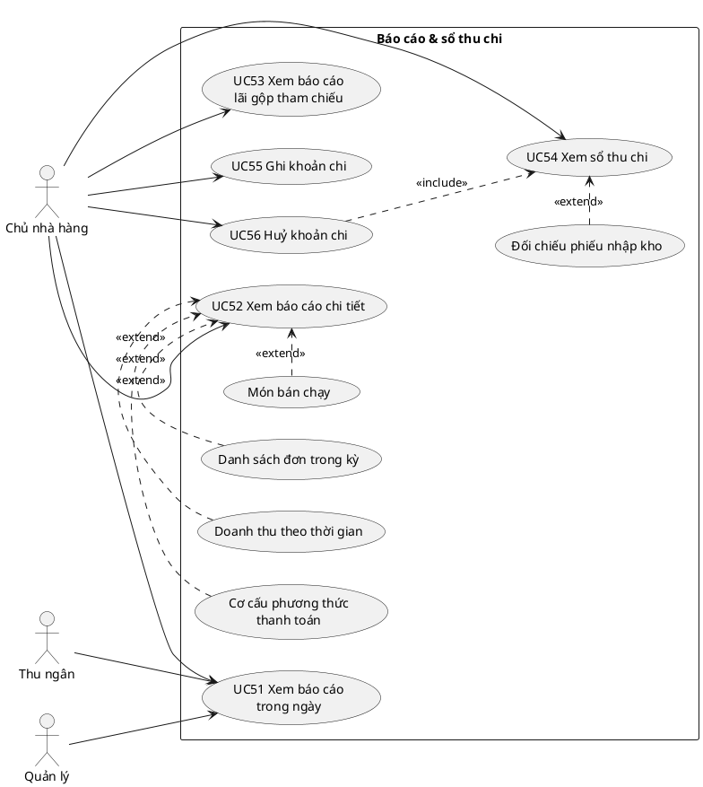

# Nhóm 11 – Báo cáo & sổ thu chi (UC51–UC56)

## Sơ đồ Use Case

---

## UC51 – Xem báo cáo trong ngày

| Thuộc tính | Nội dung |
|---|---|
| **Actor chính** | Thu ngân, Quản lý, Chủ nhà hàng |
| **Mô tả** | Xem nhanh doanh thu và số đơn của một ngày (mặc định hôm nay) theo múi giờ nhà hàng để chốt ca. |
| **Tiền điều kiện** | ĐK-A; ĐK-G(`DAILY_REVENUE`); ĐK-P(`REPORT_DAILY_VIEW`). |
| **Hậu điều kiện** | Không thay đổi dữ liệu. |

**Luồng chính**
1. Actor mở “Báo cáo hôm nay” (hoặc chọn ngày).
2. Hệ thống xác định khoảng thời gian của ngày theo múi giờ nhà hàng.
3. Hệ thống trả: tổng tiền đã thu (thanh toán thành công), số đơn hoàn tất, số đơn huỷ, phân theo tiền mặt/chuyển khoản.

**Ngoại lệ**
- 2a. Ngày không hợp lệ / ngoài phạm vi cho phép → `400`.

---

## UC52 – Xem báo cáo chi tiết

| Thuộc tính | Nội dung |
|---|---|
| **Actor chính** | Chủ nhà hàng |
| **Mô tả** | Báo cáo theo khoảng thời gian: tổng quan (tiền thu, doanh số đơn hoàn tất, số đơn, giá trị trung bình), doanh thu theo ngày/tuần/tháng, cơ cấu phương thức thanh toán, top món bán chạy, danh sách đơn trong kỳ. |
| **Tiền điều kiện** | ĐK-A; ĐK-G(`DETAIL_REPORT`); ĐK-P(`REPORT_DETAIL_VIEW`). |
| **Hậu điều kiện** | Không thay đổi dữ liệu. |

**Luồng chính**
1. Actor mở “Báo cáo”, chọn khoảng ngày (và bộ lọc loại phục vụ/kênh nếu cần).
2. Hệ thống trả tổng quan của kỳ.
3. Actor chọn các tab (extend): “Doanh thu theo thời gian” (chọn độ chi tiết ngày/tuần/tháng), “Phương thức thanh toán”, “Món bán chạy” (sắp theo số lượng/doanh thu), “Đơn hàng”.
4. Hệ thống trả dữ liệu tương ứng để vẽ biểu đồ/bảng.

**Ngoại lệ**
- 1a. Khoảng ngày đảo ngược hoặc quá dài → `400` (mã lỗi phạm vi báo cáo).

**Quy tắc nghiệp vụ**
- BR52-1: Tách bạch **tiền thực thu** (theo thời điểm thanh toán thành công) và **doanh số bán** (theo đơn hoàn tất).
- BR52-2: Mọi mốc ngày tính theo múi giờ của nhà hàng.

---

## UC53 – Xem báo cáo lãi gộp tham chiếu

| Thuộc tính | Nội dung |
|---|---|
| **Actor chính** | Chủ nhà hàng |
| **Mô tả** | Xem doanh số, giá vốn tham chiếu (chụp tại lúc gửi bếp theo công thức và giá nguyên liệu) và lãi gộp ước tính theo kỳ, theo thời gian và theo từng đơn. |
| **Tiền điều kiện** | ĐK-A; ĐK-G(`DETAIL_REPORT` + `ORDER_MANAGEMENT`); ĐK-P(`ORDER_VIEW` + `REPORT_DETAIL_VIEW`). |
| **Hậu điều kiện** | Không thay đổi dữ liệu. |

**Luồng chính**
1. Actor mở “Lãi gộp”, chọn khoảng ngày.
2. Hệ thống trả tổng doanh số, tổng giá vốn tham chiếu, lãi gộp, tỷ suất, và số đơn có giá vốn **đầy đủ / thiếu** cấu hình.
3. Actor xem biểu đồ theo thời gian và danh sách đơn kèm lãi gộp từng đơn.
4. Actor chọn một món trong đơn → xem chi tiết snapshot giá vốn.

**Luồng thay thế**
- 2a. Có đơn thiếu giá nguyên liệu → hệ thống đánh dấu `INCOMPLETE`, hiển thị cảnh báo “số liệu chưa đầy đủ”, gợi ý cập nhật giá vốn (UC18/UC20).

---

## UC54 – Xem sổ thu chi

| Thuộc tính | Nội dung |
|---|---|
| **Actor chính** | Chủ nhà hàng |
| **Mô tả** | Xem dòng tiền: khoản **thu** (thanh toán đơn thành công) và khoản **chi** (phiếu chi đã ghi), tổng hợp, chênh lệch thu chi và biểu đồ theo thời gian; đối chiếu phiếu nhập kho đã/ chưa ghi chi. |
| **Tiền điều kiện** | ĐK-A; ĐK-G(`DETAIL_REPORT`); ĐK-P(`CASHBOOK_VIEW`; đối chiếu phiếu nhập thêm `INVENTORY_VIEW` và `INVENTORY_MANAGEMENT`). |
| **Hậu điều kiện** | Không thay đổi dữ liệu. |

**Luồng chính**
1. Actor mở “Sổ thu chi”, chọn khoảng ngày, lọc loại (thu/chi), danh mục, phương thức.
2. Hệ thống trả danh sách giao dịch thu chi (phân trang), tổng thu, tổng chi, chênh lệch.
3. Actor xem biểu đồ dòng tiền theo ngày/tháng.
4. Actor chọn một phiếu chi để xem chi tiết.

**Luồng thay thế**
- 1a. (Extend) “Đối chiếu phiếu nhập”: hệ thống liệt kê phiếu nhập kho đã xác nhận cùng tổng giá trị và tổng tiền đã ghi chi liên kết.

**Quy tắc nghiệp vụ**
- BR54-1: Chênh lệch thu chi **không phải** lợi nhuận hay số dư quỹ; không tính giá vốn nguyên liệu tiêu hao.
- BR54-2: Danh mục chi: mua nguyên liệu, thuê mặt bằng, lương, điện nước, bảo trì, khác.

---

## UC55 – Ghi khoản chi

| Thuộc tính | Nội dung |
|---|---|
| **Actor chính** | Chủ nhà hàng |
| **Mô tả** | Ghi nhận một khoản tiền đã chi (tiền mặt/chuyển khoản), có thể liên kết với phiếu nhập kho để đối chiếu. |
| **Tiền điều kiện** | ĐK-A; ĐK-G(`DETAIL_REPORT`; liên kết phiếu nhập thêm `INVENTORY_MANAGEMENT`); ĐK-P(`CASHBOOK_CREATE`; liên kết phiếu nhập thêm `INVENTORY_VIEW`). |
| **Hậu điều kiện** | Phiếu chi trạng thái `POSTED` được tính vào tổng chi; ghi nhật ký. |

**Luồng chính**
1. Actor chọn “Ghi khoản chi”.
2. Actor nhập: danh mục, số tiền (> 0), phương thức, thời điểm chi (không ở tương lai), người nhận, số tham chiếu, ghi chú; tuỳ chọn chọn phiếu nhập kho liên quan.
3. Client gửi kèm `Idempotency-Key`.
4. Hệ thống kiểm tra dữ liệu; nếu có phiếu nhập: phiếu cùng nhà hàng, loại nhập, đã xác nhận, danh mục là “Mua nguyên liệu”, tiền tệ khớp.
5. Hệ thống lưu phiếu chi `POSTED` (tiền tệ mặc định theo nhà hàng) và trả kết quả.

**Ngoại lệ**
- 4a. Số tiền ≤ 0, thời điểm chi ở tương lai → `400 VALIDATION_ERROR`.
- 4b. Phiếu nhập không hợp lệ/không cùng tiền tệ → `409`/`422` tương ứng.
- E7 – gửi lặp cùng key → trả lại phiếu cũ; khác nội dung → `409 CASHBOOK_IDEMPOTENCY_KEY_REUSED`.

---

## UC56 – Huỷ khoản chi

| Thuộc tính | Nội dung |
|---|---|
| **Actor chính** | Chủ nhà hàng |
| **Mô tả** | Huỷ (void) phiếu chi ghi nhầm. Bản ghi vẫn được giữ để đối chiếu nhưng không còn tính vào tổng chi. |
| **Tiền điều kiện** | ĐK-A; ĐK-G(`DETAIL_REPORT`); ĐK-P(`CASHBOOK_VOID`). Phiếu chi ở `POSTED`. |
| **Hậu điều kiện** | Phiếu chi `VOIDED` kèm lý do, người huỷ, thời điểm; ghi nhật ký. |

**Luồng chính**
1. Actor mở chi tiết phiếu chi trong sổ thu chi (include UC54), chọn “Huỷ phiếu chi”.
2. Actor nhập lý do và xác nhận.
3. Hệ thống kiểm tra phiếu đang `POSTED`, phiên bản đúng; chuyển sang `VOIDED`.

**Ngoại lệ**
- 3a. Phiếu đã huỷ → trả trạng thái hiện tại (idempotent).
- E6 → xung đột phiên bản.
