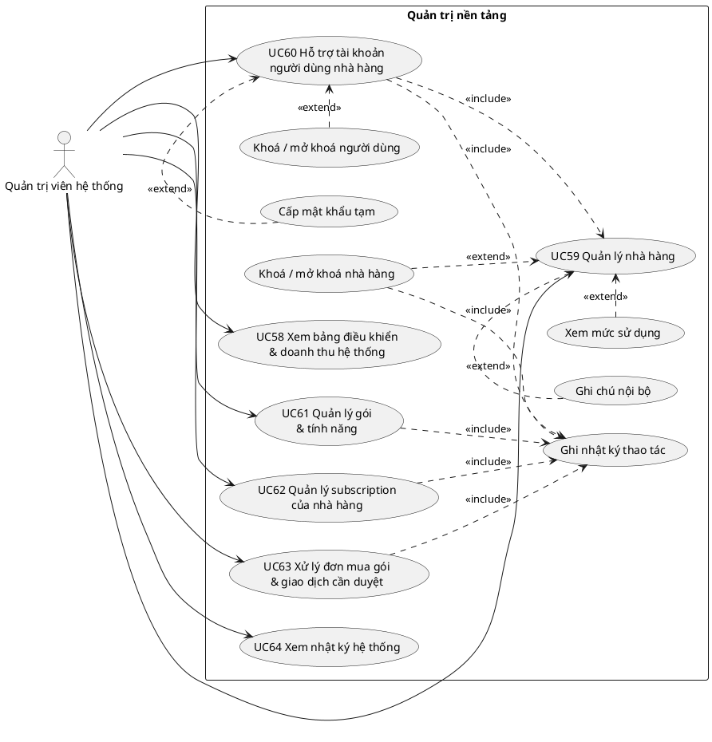

# Nhóm 12 – Quản trị nền tảng SaaS (UC58–UC64)

## Sơ đồ Use Case

> Tiền điều kiện chung của nhóm (**ĐK-S**): đăng nhập bằng tài khoản `SUPER_ADMIN` **hệ thống** (không thuộc nhà hàng nào) và có quyền tương ứng. Mọi thao tác ghi đều được lưu vào `audit_logs`.

---

## UC58 – Xem bảng điều khiển & doanh thu hệ thống

| Thuộc tính | Nội dung |
|---|---|
| **Actor chính** | Quản trị viên hệ thống |
| **Mô tả** | Xem số liệu tổng quan: số nhà hàng theo trạng thái, nhà hàng mới, subscription đang hoạt động/sắp hết hạn/đã hết hạn theo gói, danh mục gói/tính năng; doanh thu nền tảng theo tháng (tách mua online và admin gán). |
| **Tiền điều kiện** | ĐK-S; quyền `ADMIN_DASHBOARD_VIEW`. |
| **Hậu điều kiện** | Không thay đổi dữ liệu. |

**Luồng chính**
1. Admin đăng nhập, mở “Dashboard”.
2. Hệ thống trả số liệu tổng hợp nhà hàng, subscription, danh mục.
3. Admin chọn số tháng (3–24) cho biểu đồ doanh thu.
4. Hệ thống trả doanh thu theo tháng kích hoạt (múi giờ Asia/Ho_Chi_Minh).

**Ngoại lệ**
- 3a. Số tháng ngoài khoảng 3–24 → `400 VALIDATION_ERROR`.

---

## UC59 – Quản lý nhà hàng

| Thuộc tính | Nội dung |
|---|---|
| **Actor chính** | Quản trị viên hệ thống |
| **Mô tả** | Xem danh sách và chi tiết nhà hàng; khoá/mở khoá (tạm ngưng) nhà hàng; xem mức sử dụng 30 ngày so với giới hạn gói; ghi chú nội bộ phục vụ chăm sóc khách hàng. |
| **Tiền điều kiện** | ĐK-S; xem: `RESTAURANT_VIEW`; khoá/mở, ghi chú: `RESTAURANT_MANAGE`. |
| **Hậu điều kiện** | (Khi đổi trạng thái) nhà hàng `ACTIVE`/`INACTIVE`/`SUSPENDED`; ghi nhật ký `RESTAURANT_STATUS_CHANGED`, `ADMIN_RESTAURANT_NOTE_ADDED`/`DELETED`. |

**Luồng chính**
1. Admin mở “Nhà hàng”, tìm theo tên/mã/email, lọc trạng thái.
2. Hệ thống trả danh sách phân trang (mã, tên, chủ, trạng thái, gói hiện tại).
3. Admin chọn nhà hàng → hệ thống trả chi tiết hồ sơ, chủ nhà hàng, gói đang dùng.
4. (Extend) Admin chọn “Khoá nhà hàng”, nhập lý do, xác nhận → hệ thống đổi trạng thái; nhân viên của nhà hàng bị chặn đăng nhập/gọi API (`RESTAURANT_INACTIVE`), thực đơn QR ngừng hoạt động.

**Luồng thay thế**
- 4a. Mở khoá: đổi về `ACTIVE`.
- 4b. (Extend) “Mức sử dụng”: hệ thống trả số đơn, số nhân viên, số bàn… 30 ngày gần nhất so với giới hạn của gói.
- 4c. (Extend) “Ghi chú”: thêm ghi chú nội bộ / xoá mềm ghi chú.

**Ngoại lệ**
- 3a. Nhà hàng không tồn tại → `404 RESTAURANT_NOT_FOUND`; 4c-a. ghi chú không tồn tại → `404 NOTE_NOT_FOUND`.

---

## UC60 – Hỗ trợ tài khoản người dùng nhà hàng

| Thuộc tính | Nội dung |
|---|---|
| **Actor chính** | Quản trị viên hệ thống |
| **Mô tả** | Xem người dùng của một nhà hàng; khoá/mở khoá tài khoản; cấp **mật khẩu tạm** khi chủ nhà hàng quên mật khẩu. |
| **Tiền điều kiện** | ĐK-S; xem: `RESTAURANT_VIEW`; khoá/cấp mật khẩu: `RESTAURANT_MANAGE`. |
| **Hậu điều kiện** | Trạng thái tài khoản / mật khẩu thay đổi; **mọi phiên đăng nhập của người đó bị thu hồi**; ghi nhật ký `ADMIN_USER_DISABLED`/`ENABLED`/`PASSWORD_RESET` (không ghi mật khẩu vào nhật ký). |

**Luồng chính – Cấp mật khẩu tạm**
1. Admin mở chi tiết nhà hàng (include UC59) → tab “Người dùng”; hệ thống liệt kê người dùng.
2. Admin chọn người dùng → “Cấp mật khẩu tạm”, nhập lý do (xác minh yêu cầu hỗ trợ).
3. Hệ thống sinh mật khẩu ngẫu nhiên 12 ký tự, cập nhật mật khẩu băm, thu hồi phiên.
4. Hệ thống trả mật khẩu tạm **một lần duy nhất** (không lưu cache); admin chuyển cho người dùng qua kênh an toàn.

**Luồng thay thế**
- 2a. “Khoá tài khoản” / “Mở khoá”: nhập lý do → hệ thống đổi trạng thái, khoá thì thu hồi phiên.

**Ngoại lệ**
- 2b. Người dùng không thuộc nhà hàng → `404 USER_NOT_FOUND`.

---

## UC61 – Quản lý gói & tính năng

| Thuộc tính | Nội dung |
|---|---|
| **Actor chính** | Quản trị viên hệ thống |
| **Mô tả** | Quản lý danh mục **tính năng** (mã, tên, trạng thái) và **gói dịch vụ** (mã, tên, mô tả, giá, tiền tệ, chu kỳ tháng, số nhân viên tối đa, trạng thái); gán/gỡ tính năng vào gói kèm giới hạn. |
| **Tiền điều kiện** | ĐK-S; xem: `PACKAGE_VIEW`; ghi: `PACKAGE_MANAGE`. |
| **Hậu điều kiện** | Danh mục cập nhật; ghi nhật ký `FEATURE_CREATED`/`UPDATED`, `PACKAGE_CREATED`/`UPDATED`, `PACKAGE_FEATURE_ADDED`/`REMOVED`. Subscription đã kích hoạt **không bị ảnh hưởng** (dùng snapshot). |

**Luồng chính – Tạo gói mới**
1. Admin mở “Gói dịch vụ” → “Thêm gói”.
2. Admin nhập mã gói, tên, mô tả, giá, tiền tệ, chu kỳ, `maxStaff` (để trống = không giới hạn).
3. Hệ thống kiểm tra mã chưa tồn tại, tiền tệ/giới hạn hợp lệ; lưu gói.
4. Admin chọn gói → “Thêm tính năng”, chọn tính năng và giới hạn (nếu có).
5. Hệ thống gán tính năng vào gói.

**Luồng thay thế**
- 1a. Quản lý tính năng: thêm/sửa tính năng (mã, tên, mô tả, bật/tắt).
- 2a. Sửa gói (giá, mô tả, trạng thái mở bán…). Gói ngừng bán không tạo được đơn mua mới.
- 4a. Gỡ tính năng khỏi gói.

**Ngoại lệ**
- 3a. Mã gói/tính năng trùng → `409 PACKAGE_ALREADY_EXISTS` / `FEATURE_ALREADY_EXISTS`.
- 3b. Tiền tệ / giới hạn sai → `INVALID_CURRENCY_CODE` / `INVALID_PACKAGE_LIMIT` / `INVALID_STAFF_LIMIT_CONFIG`.
- 5a. Tính năng đã có trong gói → `409 PACKAGE_FEATURE_ALREADY_EXISTS`; gỡ tính năng không có → `PACKAGE_FEATURE_NOT_FOUND`.
- E6 → `409 CONCURRENT_PACKAGE_UPDATE`.

---

## UC62 – Quản lý subscription của nhà hàng

| Thuộc tính | Nội dung |
|---|---|
| **Actor chính** | Quản trị viên hệ thống |
| **Mô tả** | Gán gói thủ công cho nhà hàng (ví dụ khách trả tiền ngoài hệ thống, tặng dùng thử), kích hoạt, đổi gói, huỷ; xem subscription của mọi nhà hàng. |
| **Tiền điều kiện** | ĐK-S; xem: `SUBSCRIPTION_VIEW`; ghi: `SUBSCRIPTION_MANAGE`. |
| **Hậu điều kiện** | Subscription được tạo `PENDING` / `ACTIVE` (chụp snapshot tính năng) / đổi gói / `CANCELLED`; ghi nhật ký `SUBSCRIPTION_CREATED`/`ACTIVATED`/`PACKAGE_CHANGED`/`CANCELLED`. |

**Luồng chính**
1. Admin mở chi tiết nhà hàng → “Gói dịch vụ”; hệ thống liệt kê subscription của nhà hàng.
2. Admin chọn “Gán gói”, chọn gói, thời gian bắt đầu/kết thúc → hệ thống tạo subscription `PENDING`.
3. Admin chọn “Kích hoạt” → hệ thống khoá nhà hàng, kiểm tra không chồng lấn gói hiệu lực khác, chụp snapshot tính năng từ danh mục hiện tại, chuyển `ACTIVE`.

**Luồng thay thế**
- 3a. “Đổi gói” với subscription đang hoạt động → hệ thống cập nhật gói và snapshot mới.
- 3b. “Huỷ gói” → subscription `CANCELLED`; nhà hàng mất quyền dùng tính năng ngay.
- 1a. Xem danh sách subscription toàn hệ thống (lọc theo trạng thái, gói, nhà hàng).

**Ngoại lệ**
- 2a. Nhà hàng đã có subscription `PENDING` → `409 SUBSCRIPTION_PENDING_EXISTS`; có đơn mua đang mở → `PURCHASE_IN_PROGRESS`.
- 2b. Kỳ không hợp lệ → `INVALID_SUBSCRIPTION_PERIOD`.
- 3c. Chồng lấn gói hiệu lực → `409 SUBSCRIPTION_OVERLAP` / `SUBSCRIPTION_ALREADY_ACTIVE`.
- 3d. Chuyển trạng thái không hợp lệ → `INVALID_SUBSCRIPTION_TRANSITION`; đổi sang chính gói hiện tại → `SAME_PACKAGE_CHANGE_NOT_ALLOWED`.

---

## UC63 – Xử lý đơn mua gói & giao dịch cần duyệt

| Thuộc tính | Nội dung |
|---|---|
| **Actor chính** | Quản trị viên hệ thống |
| **Mô tả** | Xử lý thủ công các trường hợp UC16/UC17 không tự xử lý được: chuyển khoản sai số tiền/sai nội dung, tiền về sau khi đơn hết hạn, kích hoạt bị chặn… |
| **Tiền điều kiện** | ĐK-S; xem đơn: `SUBSCRIPTION_VIEW`; xử lý: `SUBSCRIPTION_PAYMENT_REVIEW`. |
| **Hậu điều kiện** | Giao dịch/đơn được giải quyết: đơn `PAID` → kích hoạt gói, hoặc `CLOSED` kèm lý do và mã bằng chứng xử lý ngoài hệ thống; ghi nhật ký `SUBSCRIPTION_PAYMENT_MANUALLY_ACCEPTED`, `..._REVIEW_CLOSED`, `..._REVIEW_RETRIED`, `SUBSCRIPTION_PURCHASE_CLOSED`, `..._ACTIVATION_RESUMED`. |

**Luồng chính – Chấp nhận giao dịch thủ công**
1. Sidebar hiển thị số giao dịch và đơn đang chờ xử lý (badge).
2. Admin mở “Giao dịch chuyển khoản”, lọc trạng thái `REVIEW_REQUIRED`; chọn một giao dịch để xem chi tiết (số tiền, nội dung, thời điểm, lý do cần duyệt).
3. Admin xác minh với chủ nhà hàng, chọn “Chấp nhận”, nhập ghi chú và chọn đơn mua tương ứng (nếu giao dịch chưa gắn đơn).
4. Hệ thống kiểm tra: giao dịch là tiền vào, đang chờ duyệt, chưa gắn đơn khác; đơn chưa có tiền và ở `PENDING_PAYMENT`/`EXPIRED`/`REVIEW_REQUIRED`.
5. Hệ thống ghi đơn `PAID`, giao dịch `CLOSED`, rồi kích hoạt gói (như UC17a).

**Luồng thay thế**
- 3a. “Thử lại”: trả giao dịch về worker xử lý lại (sau khi lỗi tạm thời đã khắc phục).
- 3b. “Đóng giao dịch”: nhập ghi chú (≥ 10 ký tự) và mã bằng chứng (≥ 3 ký tự, ví dụ mã lệnh hoàn tiền) → giao dịch `CLOSED`.
- 2a. Từ “Đơn mua gói”: xem chi tiết đơn (các lần tạo QR, giao dịch liên quan):
  - “Đóng đơn” `REVIEW_REQUIRED` → `CLOSED`, giải phóng slot để nhà hàng mua lại (hoàn tiền xử lý ngoài hệ thống);
  - “Kích hoạt lại” đơn đã nhận tiền nhưng bị chặn → về `PAID` và kích hoạt lại.

**Ngoại lệ**
- 4a. Giao dịch không ở trạng thái chờ duyệt / không phải tiền vào / đã gắn đơn khác → `PAYMENT_EVENT_NOT_IN_REVIEW` / `PAYMENT_EVENT_NOT_INCOMING` / `PAYMENT_EVENT_LINKED_ELSEWHERE`.
- 4b. Đơn đã có tiền → `PURCHASE_ALREADY_PAID`; đơn không ở diện duyệt / không kích hoạt lại được → `PURCHASE_NOT_IN_REVIEW` / `PURCHASE_NOT_RESUMABLE`.

**Quy tắc nghiệp vụ**
- BR63-1: Không tạo hoàn tiền giả, không xoá tiền đã nhận; mọi quyết định thủ công đều có lý do và người thực hiện trong nhật ký.

---

## UC64 – Xem nhật ký hệ thống

| Thuộc tính | Nội dung |
|---|---|
| **Actor chính** | Quản trị viên hệ thống |
| **Mô tả** | Tra cứu nhật ký thao tác (audit log) của toàn hệ thống hoặc của một nhà hàng: ai, làm gì, trên đối tượng nào, khi nào, từ IP nào, dữ liệu trước/sau (đã che thông tin nhạy cảm). |
| **Tiền điều kiện** | ĐK-S; quyền `AUDIT_VIEW`. |
| **Hậu điều kiện** | Không thay đổi dữ liệu. |

**Luồng chính**
1. Admin mở “Nhật ký hệ thống”.
2. Admin lọc theo phạm vi (hệ thống / nhà hàng), nhà hàng, người thực hiện, loại hành động, loại đối tượng, khoảng thời gian.
3. Hệ thống trả danh sách nhật ký phân trang, sắp xếp mới nhất trước.
4. Admin mở một bản ghi để xem chi tiết dữ liệu trước/sau.

**Ngoại lệ**
- 2a. Bộ lọc không hợp lệ (khoảng thời gian đảo ngược…) → `400 VALIDATION_ERROR`.

**Quy tắc nghiệp vụ**
- BR64-1: Nhật ký chỉ-thêm, không sửa/xoá; mật khẩu, token và dữ liệu nhạy cảm được che trước khi lưu.
